# QtPhase — Retained Hybrid CPU / Vulkan 1.3 Renderer for Unmodified Qt Widgets

> **Status: Experimental POC & Vibe coded slop
> This branch (`feat/qtphase-renderer`, based on `qtbase v6.11.2`) is an open research proof-of-concept exploring what happens when you back stock **Qt Widgets** on Linux Wayland with a **retained per-widget scene arena**, **Vulkan 1.3 SDF + HarfBuzz `hb-gpu` analytical curve text**, and **pluggable CPU-vs-GPU scheduling policies** — with **zero public Qt Widgets API changes**.
>
> TLDR: We don't have to create new GUI libraries from scratch to offload stuff to the GPU more. By making changes in even legacy GUI libraries, we can achieve modern top of the line latency, performance and efficiency. Closest to what this became would be GPUi, but this project has quirks of its own.
>
> This started when I was refreshing my mind about GUI toolkit rendering strategies. CPU rasterization has lower latency but its throughput is far lower than GPU based pipelines, which have higher FPS. The main goal initially was to explore a strategy with whereby the program uses CPU rasterization until the GPU pipeline becomes ready, by which point we would seemlessly transition to the GPU to get the benefit of higher FPS. Both pipelines would have a single dev facing API to draw stuff. Unfortunately I don't know Vulkan or low level GPU programming, so this project is vibe coded slop.
> After a successful POC with a custom widget library (which is included), I tried to challenge my own assumption that the GPU would be faster and made the pipelines race for fun! The CPU would start in the beginning until Vulkan began drawing its first frames. Then, whichever pipeline is faster for 5 frames consecutively would win and be used exclusively (the GPU was, but making them race was fun).
> After that, I was bored with the custom widget set and wanted to start Dolphin with this thing, so QT was gutted to allow for a scene graph backed QWidgets library (which mostly works, aside from a few unoptimal widget implementations! Tested with dolphin, konsole, okular and custom test programs)
> Another fun idea was to add in support for arbitrary pipeline switching policies (basically governors) (we had tried strict CPU to GPU switching and racing so far). I made the LLM come up with a few algos by itself, and the results are below. Initially those policies only had window scope metrics to rely on.
> Lastly I experimented with Widget-specific overrides for rendering pipelines, as well as allowing policies to get access to information about specific widgets
>
> Unfortunately since I'm a dummy and not proficient in GPU stuff, I can't distill the information myself. I asked the LLM to do that below. My hope is that despite the fact that this is vibe coded, that lessons could be learned from this, and that competent people could perhaps use it in the real world.
> Some screenshots have been modified (Dolphin) to hide info about me. But folders and everything displays correctly. Menus lag sometimes though. Some screenshots are from earlier in the process (examples/phase/iamges). I encourage you to compile and test this if you're into this.

---

## Live Unmodified KDE Apps Running on QtPhase Vulkan 1.3

### Stock `/usr/bin/dolphin` (Breeze Dark, RTL Arabic, HarfBuzz `hb-gpu` Text & Retained Scene Arena)
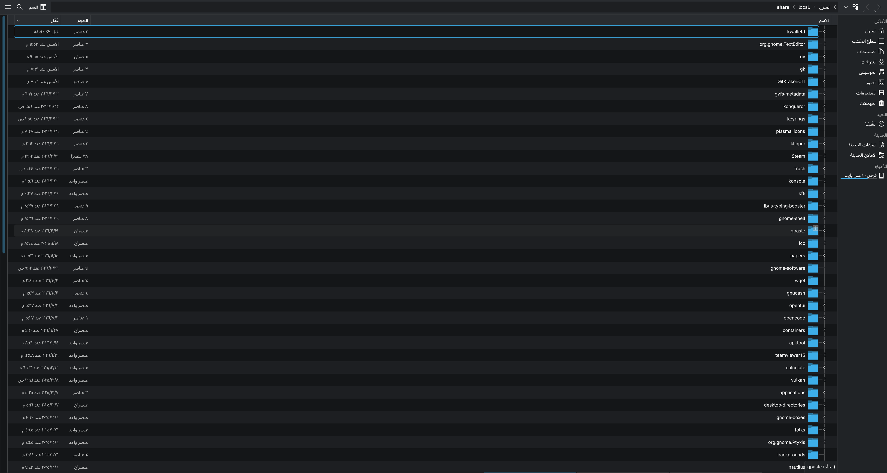

### Stock `/usr/bin/okular` (20-Page PDF, Zero-Copy `B8G8R8A8_UNORM` Uploads & Bucketed DMA-BUF Scanout)
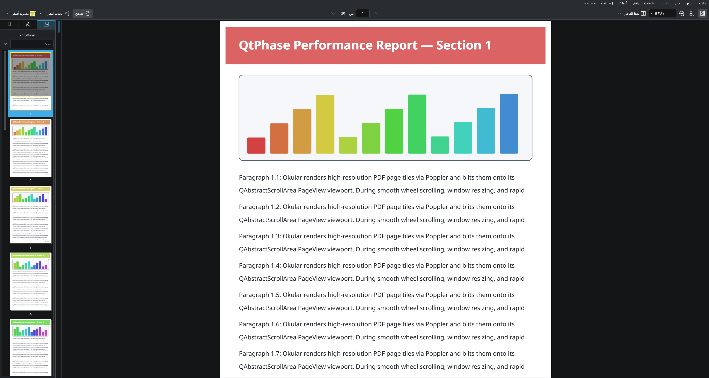

---

## Headline Results (Unmodified Stock KDE Apps on Wayland)

Measured on Fedora Linux, KWin Wayland, AMD Renoir integrated GPU (1.5× DPR), Breeze Dark + KDE Plasma platform theme, running stock `/usr/bin/dolphin`, `/usr/bin/okular`, and `/usr/bin/konsole` via `LD_LIBRARY_PATH`:

| Unmodified App & Workload | Upstream Qt (`PHASE=0`) | QtPhase (`1dd0c0ee`) | Speedup |
|---|---:|---:|---:|
| **Dolphin** interactive resize (p50 / p90) | `29.01 / 36.19 ms` | **`6.80 / 9.22 ms`** (`contextual-bandit`) | **4.3× faster** |
| **Dolphin** rapid `Key_Down` navigation (p50 / p90) | `2.05 / 2.53 ms` | **`0.71 / 2.48 ms`** (`widget-aware`) / **`0.85 / 2.27 ms`** (`async-race`) | **2.4–2.9× faster p50** |
| **Konsole** dense monospace resize (p50 / p90) | `27.56 / 34.70 ms` | **`10.46 / 13.12 ms`** (`async-race`) | **2.6× faster** |
| **Okular** 20-page PDF resize (p50) | `23.90 ms` | **`2.17–2.59 ms`** | **9–11× faster** |
| **Okular** smooth scroll from Page 1 (p50 / p90) | `7.21 / 9.29 ms` | **`1.99 ms`** (`contextual-bandit`) / **`2.24 / 7.81 ms`** (`amortized-hybrid`) | **3.2–3.6× faster p50** |
| **Okular** `pageStep` jump (p50) | `6.60 ms` | **`2.76–3.17 ms`** | **2.1–2.4× faster** |
| **Popup menu churn** (`QMenu`, p50) | `3.95 ms` | **`1.19–1.38 ms`** (`0.53 ms` CPU render, `0` Vulkan rings) | **~3× faster** |
| **Cold startup to 1st commit** (Dolphin / Okular, 3-run mean) | `234.6 ms` / `410.5 ms` | **`225.6 ms`** / **`410.2 ms`** | **No regression** (zero-wait CPU boot) |

> **Honest caveat on RAM**: Okular Peak RSS increased from `290.8 MB` (upstream) to `455–492 MB` on most GPU policies (`316.2 MB` on `upload-aware`), due to Vulkan driver overhead + DMA-BUF scanout rings + staging/image residency. See [Known Limitations & Open Research Questions](#8-verdict-known-limitations--open-research-questions).

---

## 1. Origin Story: From a One-Way Phased Thought Experiment to Stock KDE Apps

This project started from a single theoretical question:

> *"What if a rendering pipeline begins by rasterizing everything on the CPU for an application so startup is instant, and once the app finishes startup, caches everything on the GPU and transitions one-way into a full GPU-only pipeline — in contrast to permanently splitting work between CPU and GPU? Not 100% rigid: specific tasks could still be pinned GPU-only on startup or CPU-only after startup, while fonts stay on the GPU."*

From that initial premise, the design evolved through five concrete decisions:
1. **Go as low-level as possible inside `qtbase` / QPA** (not an out-of-tree wrapper): adding `QSurface::PhasedSurface` and `QWaylandPhasedWindow` directly into the Wayland QPA plugin lets CPU `wl_shm` and GPU Vulkan buffers present atomically to the *exact same* `wl_surface` with zero flicker or window recreation.
2. **Scene-graph-agnostic API + shared internal IR**: keep all flat arena tables, Buffer Device Address (BDA) pointers, and free-lists strictly private (`QPhaseSceneArena`), so both CPU (`QPhaseCpuRasterizer` + HarfBuzz `hb-raster`) and GPU (`QPhaseVulkanBackend` + HarfBuzz `hb-gpu`) execute the *exact same* scene representation.
3. **Pixel-diff driven development from Day 1**: instead of eyeballing screenshots, every core rendering stage (`Stage 1` through `Stage 7`) was gated by automated CPU ↔ Vulkan 1.3 8× amplified pixel-diff heatmaps (`parity_diff`).
4. **Competitive worker racing & per-widget affinity**: treat CPU and GPU like competing workers (or let widgets declare `QPhaseRendererAffinity::{Any, GpuOnly, CpuOnly}` with configurable `blocking` vs `non-blocking` startup, plus automatic CPU→GPU subtree bridging when `CpuOnly` and `GpuOnly` widgets coexist in the same window).
5. **The Zero-API-Change `Qt Widgets` Pivot**: once the hardened 7-stage `QtPhase` pipeline was hitting `0.16 ms` partial-damage GPU frames at 120 Hz on our native `phase_demo`, we asked the obvious question: *can we power real, unmodified KDE/Qt Widgets applications by hooking `QtWidgets` internally without changing a single public API?* That pivot exposed every real-world Wayland, Breeze, RTL, Poppler, and scheduling bottleneck documented below.

---

## 2. Visual Verification: Screenshots & Pixel Diffs

### 2.1 More Qt Widgets & Stress Suite Captures

| Qt `WidgetGallery` (Breeze Dark, live Wayland DMA-BUF) | `widgets_phase_demo` (50k-row `QTableView` + custom `QPainter` waveform, 0 QtPhase includes) |
| :---: | :---: |
| 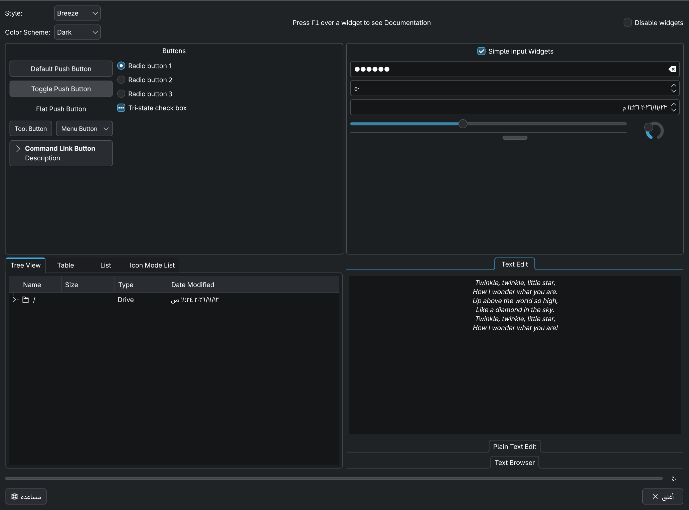 | 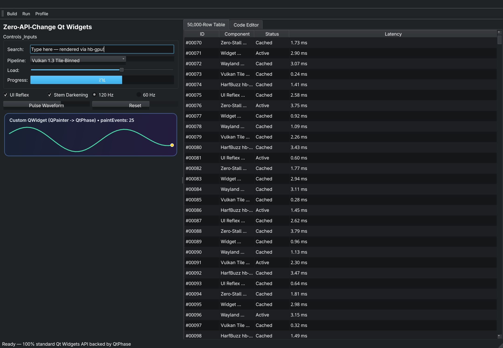 |

| `bench_adversarial` (4,300-glyph `QPlainTextEdit` + `QTreeView`, Breeze Dark) | `QTreeView` 6-Step Sub-Rect Partial Patching (QtPhase GPU vs Upstream Raster Ref) |
| :---: | :---: |
| 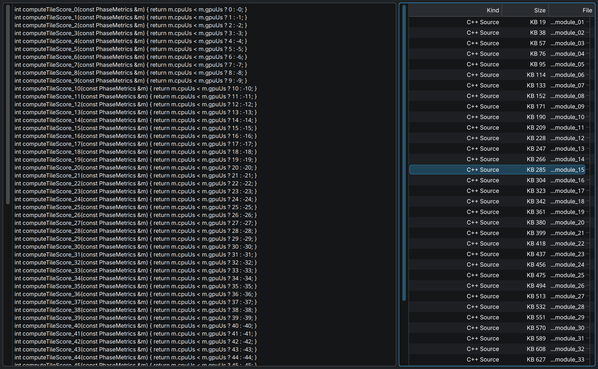 | 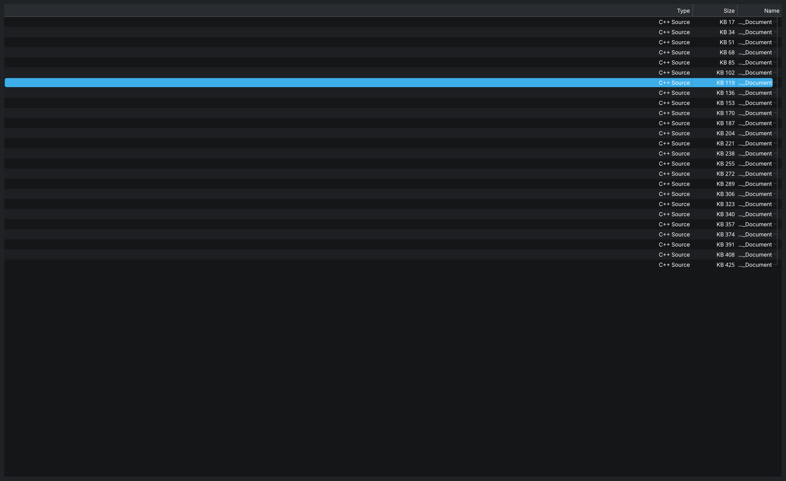<br/>*Reference raster:* [partial_patch_ref.png](examples/phase/images/partial_patch_ref.png) |

#### Real-World Bug Catch: Stock Dolphin RTL Layout Before & After (`446f25f5`)
Running unmodified Dolphin in an Arabic locale exposed LTR-ordered glyphs and left-aligned RTL chrome (`dolphin_rtl_dump.png`). Switching `QPhasePaintEngine::drawTextItem()` to reuse `QFontEngine::getGlyphPositions()` directly matched Qt's raster engine 1:1 (`dolphin_rtl_fixed.png`):

| Before (`dolphin_rtl_dump.png` — broken RTL alignment) | After (`dolphin_rtl_fixed.png` — 1:1 RTL parity) |
| :---: | :---: |
| 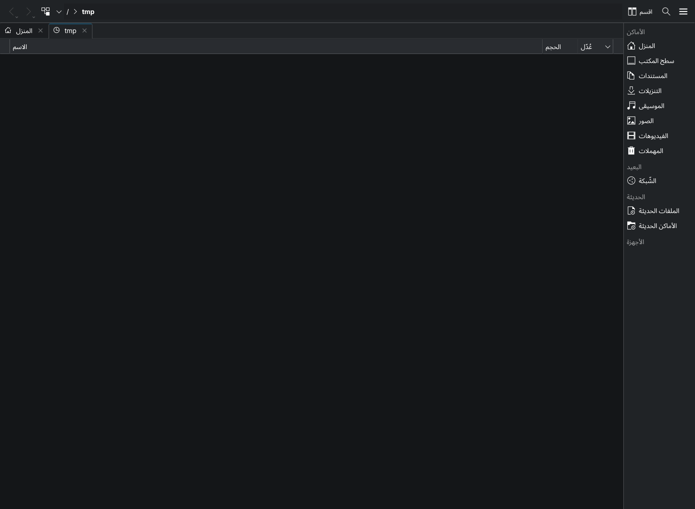 | 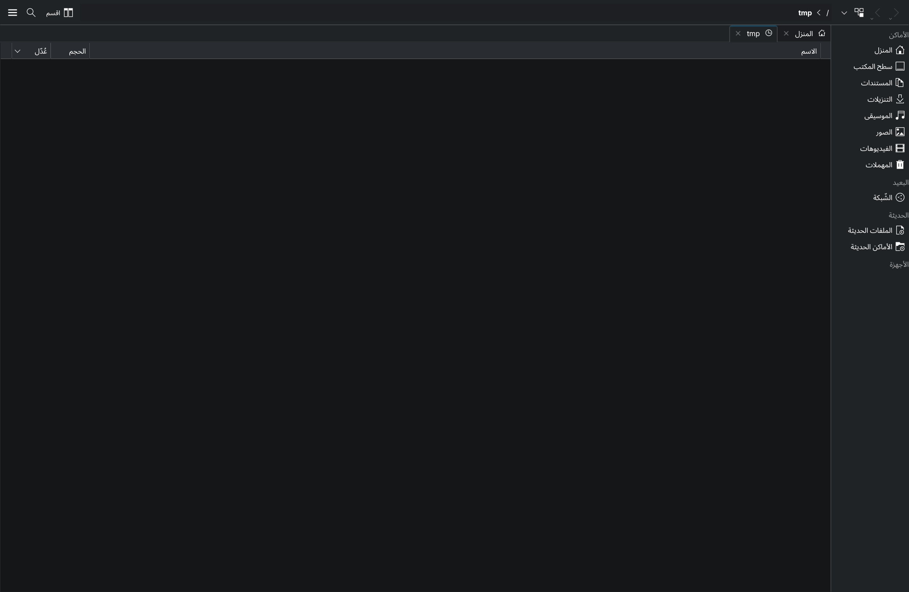 |

---

### 2.2 7-Stage CPU ↔ Vulkan 1.3 Pixel-Parity & Affinity Suite (`parity_diff`)

Every stage renders the exact same `QPhaseSceneArena` through both `QPhaseCpuRasterizer` (`wl_shm` / `hb-raster`) and `QPhaseVulkanBackend` (Vulkan 1.3 compute tile binner + uber fragment shader + `hb-gpu`), saving CPU, GPU, and **8× amplified pixel-diff heatmaps** (`900×525` @ `125%` HiDPI):

| Stage | What Is Verified | Max Channel Diff | Mean Abs Diff | CPU Render | Vulkan 1.3 GPU Render | 8× Amplified Diff Heatmap |
| :--- | :--- | :---: | :---: | :---: | :---: | :---: |
| **Stage 1** | Transforms, `-14.5 px` fractional scroll, clips, translucent rects | **`0 / 255`** | `0.00000` | 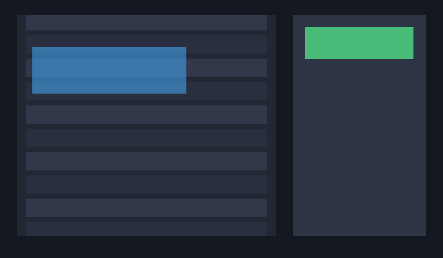 |  |  |
| **Stage 2** | Analytical SDF rounded boxes, borders, 2-stop gradients, `erf` shadows, rounded clips | **`0 / 255`** | `0.00000` |  | 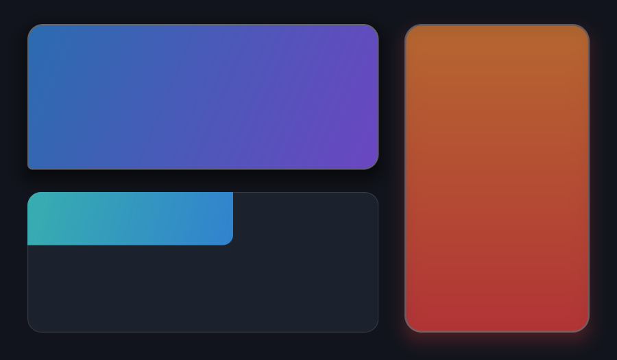 |  |
| **Stage 3** | Batched staging upload, bindless `sampler2D[]`, post-cutover CPU RAM drop (`249,856 B → 0 B`) | **`1 / 255`** | `0.00131` | 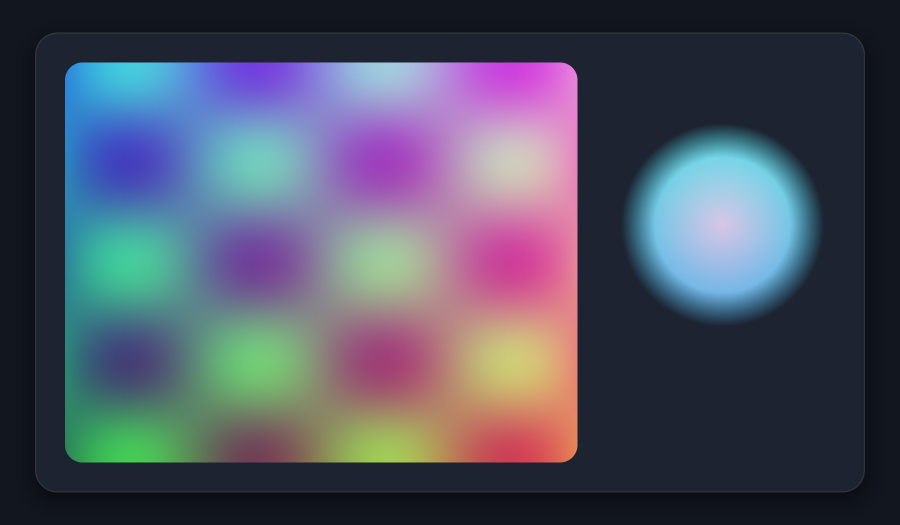 |  |  |
| **Stage 4** | HarfBuzz 15 `hb-raster` vs 1D `8×8`-baked `hb-gpu` curve text & SVGs (`12–34 px`, `74` blobs in BDA VRAM) | `22 / 255` | `0.10757` |  | 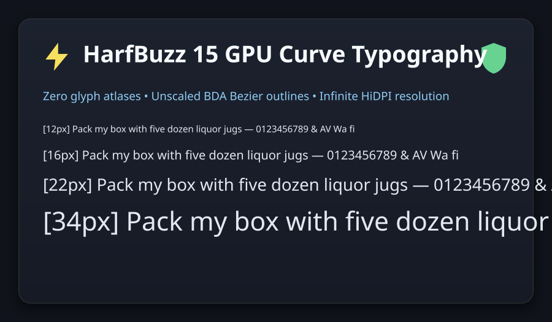 | 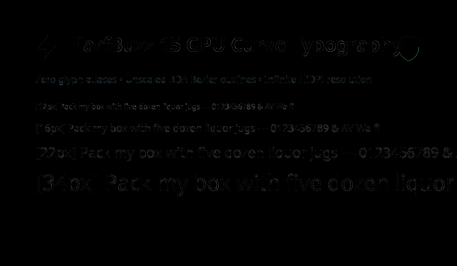 |
| **Stage 5** | Native `QtPhase` widget suite (`QGridLayoutEngine`, `QPhaseLabel`, `QPhaseTextEdit`, `QPhaseTableView`) | `21 / 255` | `0.10413` | 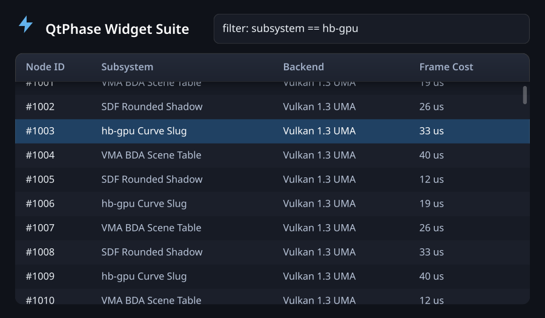 | 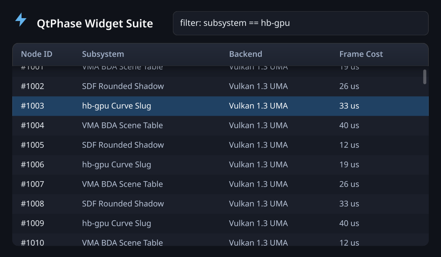 | 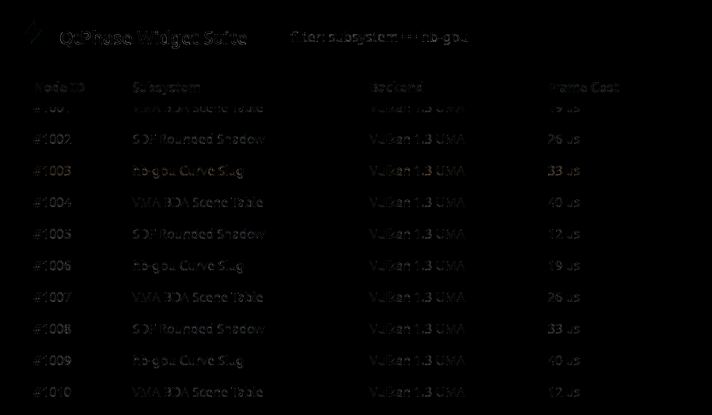 |
| **Stage 6** | Shared `VkDevice` (`196–208 µs` init), bindless slot recycle, `2×2` rotation, nested rounded clips, `StrokeSegment`, 3-deep `PushLayer`/`PopLayer` (`55%` isolated + `Screen` blend), stem darkening | `18 / 255` *(glyph AA only; `0/255` on all geometry/layers)* | `0.01864` | 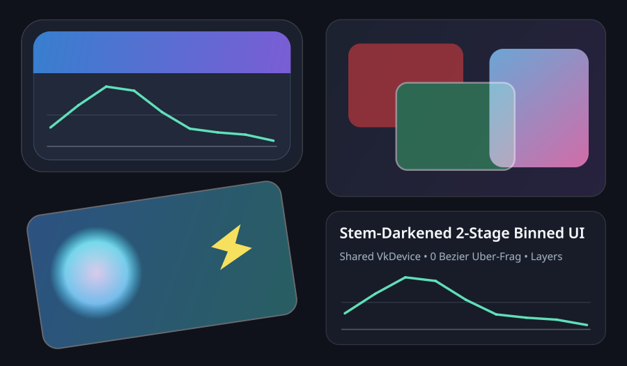 |  |  |

#### Stage 7 — Renderer Affinity & `CpuOnly` + `GpuOnly` Coexistence Bridge
When a `CpuOnly` subtree and a `GpuOnly` 3D `QPhaseGpuView` (`D32_SFLOAT` depth pass) coexist in the same window: during non-blocking CPU boot (`stage7_cpu_boot.png`), the `CpuOnly` card renders immediately while `QPhaseGpuView` reserves layout space cleanly; once Vulkan cuts over (`stage7_gpu_full.png`), `QPhaseCpuRasterizer` stays alive as a content-hashed bridge uploading only dirty `CpuOnly` subtrees side-by-side with the live 3D Vulkan pass:

| Stage 7 Non-Blocking CPU Boot (`stage7_cpu_boot.png`) | Stage 7 Steady-State GPU + CPU Bridge (`stage7_gpu_full.png`) |
| :---: | :---: |
| 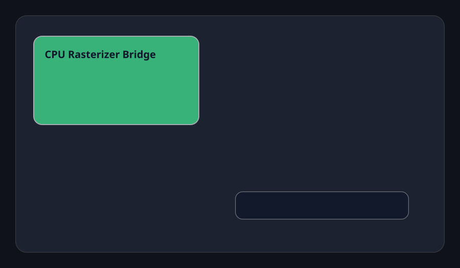 | 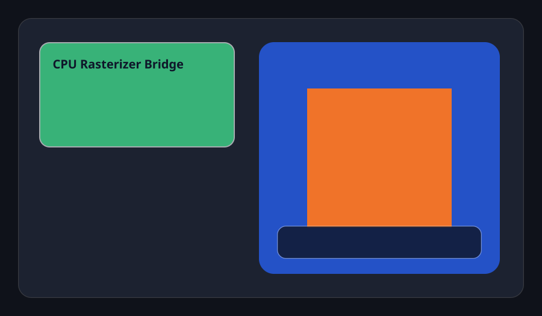 |

---

## 3. Architecture Map

The entire POC touches **57 core files** (`+19,666 / -3` lines on top of `qtbase v6.11.2`), with only **~120 lines of hook code** inside existing `QtWidgets` classes (`qwidget.cpp`, `qwidget_p.h`, `qwidgetrepaintmanager.cpp`, `qwidgetwindow.cpp`):

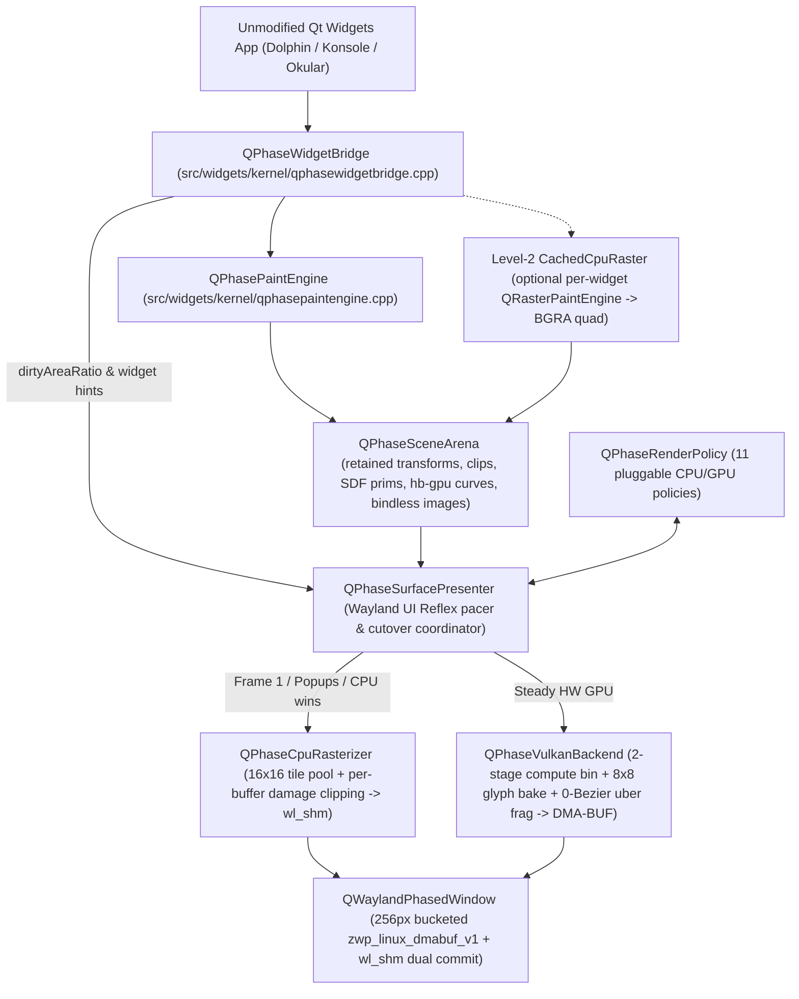

### Key Files to Read First
| Layer | Files | Role |
|---|---|---|
| **Widgets Seam** | [qwidgetwindow.cpp](src/widgets/kernel/qwidgetwindow.cpp), [qwidgetrepaintmanager.cpp](src/widgets/kernel/qwidgetrepaintmanager.cpp), [qwidget_p.h](src/widgets/kernel/qwidget_p.h) | Minimal (~120 LoC) opt-in hook attaching `QPhaseWidgetBridge` to top-level `QWidgetWindow`s |
| **Retained Tree & Hybrid Bridge** | [qphasewidgetbridge_p.h](src/widgets/kernel/qphasewidgetbridge_p.h), [qphasewidgetbridge.cpp](src/widgets/kernel/qphasewidgetbridge.cpp) | Per-`QWidget` arena node lifecycle, sub-rect opaque-cover partial patching, Level-1 dirty-widget hints, Level-2 `CachedCpuRaster` |
| **`QPainter` Translator** | [qphasepaintengine_p.h](src/widgets/kernel/qphasepaintengine_p.h), [qphasepaintengine.cpp](src/widgets/kernel/qphasepaintengine.cpp) | Translates `QPainter` calls into analytical SDF primitives, zero-alloc monochrome `hb-gpu` glyphs, bindless images, or hashed raster fallbacks |
| **Retained Scene Arena** | [qphasescenearena_p.h](src/phase/qphasescenearena_p.h), [qphasescenearena.cpp](src/phase/qphasescenearena.cpp) | Free-list primitive/transform/clip/image tables, monotonic slot generations for damage diffing, `hb-gpu` curve & face-flag caches, background CPU calibration clones |
| **Pluggable Policy Framework** | [qphaserenderpolicy_p.h](src/phase/qphaserenderpolicy_p.h), [qphaserenderpolicy.cpp](src/phase/qphaserenderpolicy.cpp) | 11 built-in `QPhaseRenderPolicy` implementations selected via `QT_PHASE_POLICY=<name>` |
| **Surface Presenter** | [qphasesurfacepresenter_p.h](src/phase/qphasesurfacepresenter_p.h), [qphasesurfacepresenter.cpp](src/phase/qphasesurfacepresenter.cpp) | Coordinates zero-wait CPU boot, async Vulkan init, per-buffer CPU damage history, background CPU calibration, and resize immediate commits |
| **Vulkan 1.3 Backend & Shaders** | [qphasevulkanbackend.cpp](src/phase/vulkan/qphasevulkanbackend.cpp), [phase_glyph_bake.comp](src/phase/shaders/phase_glyph_bake.comp), [phase_prim_prep.comp](src/phase/shaders/phase_prim_prep.comp), [phase_tile_bin.comp](src/phase/shaders/phase_tile_bin.comp), [phase_uber.frag](src/phase/shaders/phase_uber.frag) | Shared `VkDevice` cache (~200 µs secondary init), 256 px-bucketed DMA-BUF scanout, FIFO bindless cooldown, zero-copy `B8G8R8A8_UNORM` uploads, 2-stage compute tile binning + zero-Bézier uber fragment shader (~1,250 LoC of GLSL total) |
| **CPU Tile Rasterizer** | [qphasecpurasterizer.cpp](src/phase/cpu/qphasecpurasterizer.cpp), [qphasesharedmath_p.h](src/phase/cpu/qphasesharedmath_p.h) | Multi-threaded 16×16 tile rasterizer sharing exact SDF/blend/stem-darkening math with Vulkan, with per-buffer damage-region clipping |
| **Wayland Integration** | [qwaylandphasedwindow.cpp](src/plugins/platforms/wayland/qwaylandphasedwindow.cpp) | Dual `wl_shm` + `zwp_linux_dmabuf_v1` + `wp_viewport.set_source` atomic main-thread commit on a single `wl_surface` |

### What Makes Both Pipelines Special

Most hybrid UI architectures either run two completely unrelated renderers (e.g., Skia CPU vs. GPU with divergent code paths) or hard-partition rendering at the toolkit boundary. QtPhase's two pipelines are designed from the ground up as **twin executors over a single retained scene arena** (`QPhaseSceneArena`), sharing exact analytical math (`qphasesharedmath_p.h`) and presenting atomically to the **same `wl_surface`** (`QWaylandPhasedWindow`):

#### 1. The Retained Scene Arena & Frontend Seam (`QPhaseSceneArena` + `QPhaseWidgetBridge`)
- **Zero-`paintEvent` widget moves & sub-rect primitive splicing**: Every `QWidget` owns retained transform, clip, and primitive slots. Moving a widget updates a 32-byte `PhaseResolvedTransform` (full 2×2 affine matrix + opacity) without invoking `paintEvent()`. Small updates inside opaque viewports (`KItemListView`, `QTreeView`, `QTextEdit`) splice only the dirty sub-rect's primitives in place.
- **Zero-allocation monochrome glyph submission**: `QPhasePaintEngine::drawTextItem()` caches `hb_face_t` color-table flags once per face, caches whitespace glyphs as `0u`, and emits monochrome glyph runs directly into the primitive buffer with zero `QRawFont`/`QList`/`QGlyphRun` heap churn — accelerating *both* CPU and GPU pipelines.
- **Atomic dual-transport Wayland surface**: `QWaylandPhasedWindow` switches transparently between `wl_shm` (CPU) and `zwp_linux_dmabuf_v1` (GPU) on the exact same `wl_surface` without recreating windows, losing input focus, or flickering.

#### 2. The Vulkan 1.3 GPU Pipeline (`QPhaseVulkanBackend`)
- **No `VkSwapchainKHR` on Wayland — 256 px-Bucketed Tiled DMA-BUF Scanout**: Conventional Wayland Vulkan apps stall for `5–25 ms` tearing down and recreating `VkSwapchainKHR` on every pixel of a resize drag and fight cross-thread `ack_configure` races. QtPhase allocates 256 px-bucketed tiled GPU images (`VK_EXT_external_memory_dma_buf` + `SYNC_FD`) cropped cleanly via `wp_viewport.set_source` and committed on the main thread, dropping resize submit+present to **`0.4–0.7 ms`**.
- **2-Stage `O(drawCount)` Coarse-to-Fine Compute Tile Binning**: `phase_prim_prep.comp` computes bounds and atomically populates 32-bit primitive visibility masks per `128×128` super-tile; `phase_tile_bin.comp` scans only set bits with `findLSB()` (skipping 32 non-overlapping primitives in one instruction) and tracks `lastFullOccluder` for front-to-back opaque culling — hitting **`0.16 ms`** GPU execution on localized updates at `2157×1496`.
- **HarfBuzz 15 `hb-gpu` Analytical Curve Text + 1D `8×8`-Block Compute Baking**: Glyphs and SVG vectors are stored once as unscaled Bézier curve blobs in Buffer Device Address (BDA) VRAM (zero font-size glyph-atlas thrashing). `phase_glyph_bake.comp` bakes only cache-missed `8×8` blocks into a process-shared `2048×2048 R8_UNORM` scratch atlas (**97.8% hit rate** on live `phase_demo`), removing all ~220 lines of Bézier root-solving loops from `phase_uber.frag`.
- **Zero-VRAM Single-Pass Layer Stack & Nested Rounded Clips**: `phase_uber.frag` evaluates 4-hop nested rounded-clip chains and a 3-deep in-register `PushLayer`/`PopLayer` group-opacity & blend stack (`Normal`, `Multiply`, `Screen`, `Additive`) in a single render pass with **`0 MB` of offscreen FBO allocations**.
- **Process-Wide Shared `QPhaseSharedVulkanDevice` + Zero-Stall Bindless Uploads**: All windows share one `VkDevice`, VMA allocator, compiled pipelines, and glyph atlas (`~200 µs` secondary window init, `0 B` VRAM when all GPU surfaces close). Images upload via batched DMA staging (zero-copy `ARGB32_Premultiplied`/`RGB32` → `VK_FORMAT_B8G8R8A8_UNORM`), bindless slots recycle via FIFO cooldown (zero pipeline stalls), and per-slot damage trackers preserve unchanged pixels via `VK_ATTACHMENT_LOAD_OP_LOAD` + up to 8 scissor draws.

#### 3. The CPU Tile-Pool Pipeline (`QPhaseCpuRasterizer` + `QPhaseSurfacePresenter`)
- **Zero-Wait Cold Start & Zero-VRAM Transient Windows**: Paints Frame 1 immediately into 256-byte-aligned `memfd` `wl_shm` buffers while Vulkan warms up asynchronously, and handles short-lived `Qt::Popup`/`Qt::ToolTip` windows permanently in **`0.53 ms`** without allocating Vulkan DMA-BUF rings.
- **Bit-Exact Shared Analytical Math + HarfBuzz `hb-raster`**: Multi-threaded `16×16` tile workers evaluate the exact same SDF rounded boxes, `erf` Gaussian shadows, 4-hop rounded clips, 3-deep in-register `PushLayer`/`PopLayer` blend stack, and luminance-aware stem darkening as the Vulkan shaders (`0/255` diff on Stages 1, 2, and Stage 6 geometry/layers), paired with HarfBuzz 15 `hb-raster` for curves.
- **Per-Buffer `wl_shm` Damage History**: Each `wl_shm` ring slot maintains its own `QPhaseDamageTracker` (using monotonic primitive slot generations `m_primSlotGens` to avoid free-list recycling false positives), so localized edits rasterize only dirty `16×16` tiles (**~10× faster** on `QTreeView` partial updates: `17.5–23.0 ms → 1.61–1.81 ms`).
- **Live Conflict Bridge & Off-Thread Calibrator**: Doubles as an on-demand subtree rasterizer for `CpuOnly` widgets coexisting inside a GPU window (`Stage 7`, content-hashed so static subtrees cost `0 ns`), and runs asynchronous scene-clone calibrations (`cloneForCpuCalibration()`) off the UI thread so scheduling policies get genuine CPU timings with **`0 ms`** UI stall.

---

## 4. Overview of the 11 Scheduling Policies (`QPhaseRenderPolicy`)

Every window is governed by a pluggable `QPhaseRenderPolicy` ([qphaserenderpolicy_p.h](src/phase/qphaserenderpolicy_p.h), [qphaserenderpolicy.cpp](src/phase/qphaserenderpolicy.cpp)) selected at runtime via `QT_PHASE_POLICY=<name>`. Before each frame, `QPhaseSurfacePresenter` calls `decide(QPhaseSurfaceCaps, QPhaseFrameRequest)` (passing hardware/software GPU status, popup/dialog flags, dirty area ratio, pending upload bytes, inter-frame interval, and dirty widget semantic hints) and reports back measured CPU work, Vulkan hardware timestamps (`VK_QUERY_TYPE_TIMESTAMP`), and off-thread CPU calibration timings via `recordOutcome()` and `recordAsyncCpuSample()`.

> All adaptive policies respect explicit per-widget `QPhaseRendererAffinity` (`CpuOnly` / `GpuOnly` / `hasGpuOnlyViews`) and automatically fall back to CPU if Vulkan initialization fails.

### Static & One-Way Race Policies (5)

| Policy | Mechanism & Key Rules | Intended Use / Empirical Result |
|---|---|---|
| **`async-race`** *(default)* | Locks popups/tooltips and tiny Frame-0 surfaces (`≤ 320×240`) permanently to CPU `wl_shm`. Main windows boot on CPU during warmup, submit async GPU frames (`0 ms` stall) once warm, and trigger a 1-frame off-thread CPU clone calibration (`cloneForCpuCalibration()`). Once both GPU (`submit + hw`, min of initial frames) and CPU times arrive, locks permanently to GPU if `gpuCostUs ≤ cpuSampleUs + 1.5 ms` (else CPU). Software Vulkan still runs a 1-frame sync probe. | **Best overall latency winner today.** Zero startup stall, real CPU baseline (fixes Okular misclassification), zero mid-session switch spikes, `0.53 ms` CPU popups. |
| **`sync-race`** | Original 1-frame synchronous probe baseline. Boots on CPU during warmup, runs 1 blocking GPU probe frame once warm, and compares `gpuHwUs < lastCpuUs` (falling back to a hardcoded `4.0 ms` guess if Vulkan warmed up before Frame 1). | **Falsified / superseded by `async-race`.** Misclassified Okular onto CPU (`64 ms` resize) whenever Vulkan warmed before Frame 1 because `4.93 ms > 4.0 ms` fake CPU guess. |
| **`hw-gpu`** | Control baseline from `64ca68ff`. Hardware GPUs lock straight to Vulkan as soon as warmup finishes with zero probing; software Vulkan (`llvmpipe`) runs a 1-frame sync probe. | Fast static hardware baseline, but allocates GPU rings even for popups/tooltips and never empirically verifies GPU speed on hardware GPUs. |
| **`cpu-only`** | Forces every surface and frame unconditionally onto `QPhaseCpuRasterizer` (`wl_shm`). | Pure CPU baseline for A/B comparison (and verifying per-buffer CPU partial-tile damage). |
| **`gpu-only`** | Forces every surface (including popups/tooltips) onto Vulkan GPU once warm (falls back to CPU only on Vulkan failure). | Pure GPU baseline; highlighted popup ring allocation overhead (`0/11` CPU/GPU popups vs `async-race`'s `7/0`). |

### Dynamic / Adaptive Hybrid Policies (6)

| Policy | Mechanism & Key Rules | Intended Use / Empirical Result |
|---|---|---|
| **`dynamic-hybrid`** | Continuous EWMA-tracked (`3/4` decay) hysteresis switcher with CPU popups. Demotes GPU → CPU after `4` consecutive tiny localized edits (`dirty < 15%`, upload `< 512 KB`, `≥ 4` frames since switch) or `4` consecutive frames where GPU loses to CPU (`> 1.25× + 1 ms`). Promotes back immediately on resize/animation or `dirty ≥ 30%` (after `2`-frame cooldown). | **Thrashed on interactive workloads** (`8` switches on Dolphin, `KeyNav p90 = 12.23 ms`) because repeated `wl_shm` cold-buffer transitions hurt tail latency. |
| **`amortized-hybrid`** | Breakeven-cost controller designed to fix `dynamic-hybrid` thrashing. Explicitly models the `~2×` full-frame `wl_shm` cold-init switch penalty and accumulates estimated partial-CPU savings per small frame (`dirty < 16%`, upload `< 512 KB`). Only demotes GPU → CPU after `≥ 10` consecutive small frames whose cumulative savings exceed the switch cost (or `6` GPU losses), and requires `2` consecutive large frames (`dirty ≥ 30%`) or resize/animation to promote back. | Cut switches in half vs. `dynamic-hybrid` and delivered the lowest Okular scroll tail (`p90 = 7.81 ms`), though a single switch still caused a `p90` spike on Dolphin `KeyNav`. |
| **`cadence-power`** | Laptop/APU power-oriented cadence governor with CPU popups. Keeps fast interactive bursts (`< 65 ms` inter-frame gap with `dirty ≥ 20%`, resizes, animations) on GPU while clocks are boosted, and demotes after `3` consecutive sparse small updates (`≥ 140 ms` between frames, `dirty < 25%`, upload `< 512 KB` — slow typing, blinking cursors, 1 Hz ticks) to CPU partial-tile so the GPU stays asleep. Promotes immediately on resize/animation or `2` fast bursts. | **Cleanest power/idle hybrid.** `0` switches on Dolphin & Okular, and **1 clean switch** on Konsole during sparse `160 ms` typing (`2.62 ms` CPU, 0 GPU wakeups). Prime candidate for dGPU D3cold testing. |
| **`upload-aware`** | Texture-churn guard with CPU popups. Keeps normal UI and intermittent uploads (like Okular PDF page arrivals) on GPU, but detects `4` consecutive non-resize frames with `pendingUploadBytes ≥ 512 KB` (e.g., animated `emitRasterFallback()` canvases) and demotes to CPU until `12` calm frames (`< 256 KB`) or resize. | **Falsified on speed.** Demoting animated fallback canvases was **2× slower** (`25.60 ms` vs `13.10 ms` GPU) because `emitRasterFallback()` already rasterizes to a `QImage`, causing double-rasterization on CPU. |
| **`contextual-bandit`** | 2-context online learner (`SmallDamage`: `dirty < 18%`, non-resize/non-anim vs. `LargeDamage`) with CPU popups and zero hardcoded latency thresholds. Calibrates `LargeDamage` CPU off-thread; once `SmallDamage` has GPU data and `≥ 6` small frames, runs a 3-frame CPU probe (2 warm-up frames + 1 measured partial-damage frame). Picks `argmin(EWMA_cpu, EWMA_gpu)` whenever the alternative wins by `≥ 15%` (after `8`-frame cooldown, or immediately on resize), and re-probes every `150` large frames to adapt to GPU contention. | **Strongest adaptive performance learner.** Won Dolphin resize (`6.80 / 9.22 ms`), Dolphin `KeyNav` p90 (`2.26 ms` pre-glyph), and Okular scroll p50 (`1.99 ms`) with zero hand-tuned thresholds. |
| **`widget-aware`** | Semantic widget-hint + cadence + calibration governor fed by Level-1 `QPhaseWidgetBridge` classification (`QPhaseSurfaceHint`). Permanently routes popups, tooltips, and small non-scrolling dialogs (`QDialog` `≤ 800×600` without scroll viewports) to CPU `wl_shm`. Keeps active `ScrollViewport`, `HeavyCanvas`, resize, and animation bursts on GPU; demotes `3` consecutive sparse localized `TextInput` / `ControlChrome` updates (`≥ 120 ms` gap, `dirty < 20%`, no heavy/scroll hints) to CPU partial-tile; falls back to CPU if software Vulkan loses after calibration. Pairs with Level-2 per-widget `CachedCpuRaster` (`QT_PHASE_WIDGET_HYBRID=correctness\|aggressive\|off`). | **Top-tier latency + semantic awareness.** Hit **`0.71 ms` p50** on Dolphin `KeyNav` while keeping popups, simple dialogs, and sparse chrome/text ticks off the GPU. |

---

## 5. The Full Investigation: Five Empirical Cycles & Falsified Hypotheses

### Cycle 1 — Core Pipeline, HarfBuzz `hb-gpu`, Game-Engine Upgrades & Affinity (`761ca65d`)
- **Replacing our custom CPU text rasterizer with HarfBuzz `hb-raster`**: Inspecting early Stage 4 PNG diffs showed our custom CPU outline rasterizer carried maintenance burden for zero benefit over HarfBuzz 15's `hb-raster`, so both pipelines standardized on HarfBuzz (`hb-raster` CPU ↔ `hb-gpu` GPU).
- **2-Stage `O(drawCount)` Coarse-to-Fine Compute Tile Binning** (`phase_prim_prep.comp` + `phase_tile_bin.comp` with `128×128` super-tile 32-bit masks scanned via `findLSB()`): cut localized partial-damage GPU execution **4.5×** (`0.72 ms → 0.16 ms` at `2157×1496`).
- **Zero-Bézier `phase_uber.frag`**: Moved all `hb-gpu` Bézier root-solving into a 1D `8×8`-block compute baker (`phase_glyph_bake.comp`) writing a shared `2048×2048 R8_UNORM` atlas (**97.8% hit rate** on live 120 Hz `phase_demo`: `67,378` hits / `1,541` bakes, **`6.68 ms`** avg input-to-present at `120.0 Hz`, `0.33–0.55 ms` CPU submit).
- **Zero-VRAM 3-Deep Isolated Layer Stack**: Added `savedLayer0..2` in-register `PushLayer`/`PopLayer` (`Normal`, `Multiply`, `Screen`, `Additive`) and 4-hop nested rounded-clip chains in a single render pass with `0 MB` offscreen FBOs.
- **Process-Wide Shared `QPhaseSharedVulkanDevice`**: Secondary windows reuse `VkDevice`, VMA, all 4 pipelines, and the R8 glyph atlas in **~200 µs**, dropping VRAM back to `0 B` via `std::weak_ptr` when all GPU surfaces close.

### Cycle 2 — The `Qt Widgets` Pivot & Killing `VkSwapchainKHR` on Wayland (`d8057d9d` → `e0d2d1ac`)
- Running `widgets_phase_demo` and Qt's `WidgetGallery` with Breeze Dark exposed brutal real-world failures in the original dual-thread `VkSwapchainKHR` design: `xdg_popup` already-mapped Wayland protocol crashes, missing controls/italics, black windows, **5.6–22.6 ms resize stalls** inside `vkCreateSwapchainKHR` + `vkDeviceWaitIdle`, and LIFO bindless slot stalls (`8–13 ms`).
- **The architectural fix (`e0d2d1ac`)**:
  1. **Killed `VkSwapchainKHR` on Wayland** for `QPhaseSurfacePresenter` → rendered directly into **256 px-bucketed tiled Vulkan DMA-BUF `wl_buffers`** (`VK_EXT_external_memory_dma_buf` + `SYNC_FD` + `wp_viewport.set_source`) committed atomically on the main thread. Resize submit+present plummeted from **`5.6–22.6 ms → 0.4–0.7 ms`**, and cross-thread `ack_configure` vs `vkQueuePresentKHR` races vanished structurally.
  2. **FIFO cooldown bindless slot recycling**: holding freed descriptor slots for `kFramesInFlight + 1` frames eliminated `8–13 ms` GPU sync stalls.
  3. **Collapsed 3-arena per-window worker threads** into a single-arena `QPhaseSurfacePresenter` (972 → 469 LoC).

### Cycle 3 — Real KDE Apps: Dolphin, RTL Arabic, Sub-Rect Patching & Okular BGRA (`446f25f5` → `a1a53d5d`)
- **Dolphin + Breeze (`64ca68ff`)**: Zero-wait async Frame 1 eliminated the cold Vulkan startup tax (`225.6 ms` vs `234.6 ms` upstream 3-run mean), and opaque-cover sub-rect partial patching dropped `Key_Down` from full viewport repaints to `1.88 ms` (vs `2.37 ms` upstream) while resize hit `7.57 ms` vs `29.98 ms` (**4.0× faster**).
- **Okular 20-Page PDF (`a1a53d5d`)**: Zero-copy `Format_ARGB32_Premultiplied` / `Format_RGB32` → `VK_FORMAT_B8G8R8A8_UNORM` (+ `A=1` swizzle) single-`memcpy` uploads + `VMA_MEMORY_USAGE_AUTO_PREFER_HOST` staging shrink (`> 4 MB`) delivered `410.2 ms` vs `410.5 ms` startup, **`2.66 ms` vs `24.03 ms` resize (9×)**, **`2.37 ms` vs `7.17 ms` smooth scroll (3×)**, and **`3.12 ms` vs `6.74 ms` page jumps (2.2×)**.

### Cycle 4 — Pluggable 11-Policy Arena & 10× CPU Partial-Tile Damage Fix (`fcf893df` → `20191201`)
- Rather than hardcoding GPU assumptions based on 2 apps, we built **`QPhaseRenderPolicy`** (`QT_PHASE_POLICY=<name>`) with **11 policies**: `async-race` *(default)*, `sync-race`, `hw-gpu`, `cpu-only`, `gpu-only`, `dynamic-hybrid`, `amortized-hybrid`, `cadence-power`, `upload-aware`, `contextual-bandit`, and `widget-aware`.
- **The `sync-race` False-Demotion Bug**: Comparing measured GPU time (`4.93 ms` on Okular) against a fake `4.0 ms` CPU guess when Vulkan finished before Frame 1 misclassified Okular permanently onto CPU (**`64 ms` resize**). Fixed in `async-race` by cloning the scene arena (`cloneForCpuCalibration()`) and measuring real CPU raster cost on a background thread (`cpu_calib = 24.88 ms` on Okular, `0 ms` UI stall).
- **10× Faster CPU Partial Updates (`20191201`)**: `presentCpuFrame()` previously passed `nullptr` damage to `renderToBuffer()`, and `QPhaseDamageTracker` had a subtle free-list bug where slot recycling shifted `survivingCurOrder` indices into a false full-screen dirty cascade. Adding per-buffer `wl_shm` damage history (`CpuBootBufferState`) + monotonic `m_primSlotGens` dropped `QTreeView` partial CPU raster from **`17.5–23.0 ms` → `1.61–1.81 ms` (~10×)** and Dolphin `cpu-only` `Key_Down` from **`11.53 ms` → `4.52 ms` (2.5×)**.

### Cycle 5 — Falsified Hypotheses & Zero-Alloc Monochrome Glyph Fast Path (`1dd0c0ee`)
Running the 36-run Policy Arena and testing widget-aware routing **falsified three intuitive hypotheses**:
1. **`upload-aware` lost 2× on dynamic fallback canvases (`25.60 ms` vs `13.10 ms` GPU = `13.08 ms` upstream)**: `emitRasterFallback()` *already* rasterizes complex paths into a `QImage`; zero-copy GPU upload adds `< 1 ms`, whereas demoting to `QPhaseCpuRasterizer` forces **double-rasterization** (CPU `QPainter` → `QImage` → scalar CPU resample into `wl_shm`).
2. **`dynamic-hybrid` thrashed on rapid interactive edits (`8` switches on Dolphin, `p90 = 12.23 ms`)**: Mid-window DMA-BUF ↔ `wl_shm` switches pay a cold-buffer transition spike that erases small-damage CPU gains.
3. **Level-2 `CachedCpuRaster` aggressive mode lost 2× on Konsole (`20.97–21.21 ms` p50, `40.88 ms` p90 vs `10.46–10.91 ms` native Vulkan)**: Native `HbGpuCurve` beats `QRasterPaintEngine` + uploading a 7 MB viewport texture every resize by **2×**. Level-2 therefore defaults to `correctness` mode (`CompositionMode != SourceOver`, curved `clipPath`, `QGraphicsEffect`), while `QT_PHASE_WIDGET_HYBRID=aggressive` remains toggleable for experiments.
- **The Real Win — Zero-Alloc Monochrome Glyph Fast Path**: Caching `hb_face_t` color-table flags once per face, caching whitespace glyphs (`' '`) as `0u` instead of calling `hb_gpu_draw_encode()` every frame, eliminating the per-primitive `std::vector<uint32_t>` clip copy, and bypassing `QRawFont`/`QList`/`QGlyphRun`/`QPhaseVisuals` for monochrome runs cut `QPlainTextEdit` 4,300-glyph sync in **half** (`10.7–12.3 ms` → **`5.44 ms`**), dropped Dolphin `KeyNav` to **`0.71–0.85 ms`**, and dropped Konsole resize to **`10.46 ms`**.

---

## 6. Full Benchmark Data

> **Environment**: Fedora Linux, KWin Wayland, AMD Renoir APU (1.5× DPR), Breeze Dark + KDE Plasma theme.  
> **Note**: Sections 6.1–6.4 are the 36-run single-trial Policy Arena sweeps taken just before the Cycle 5 glyph fast path; Section 6.5 shows the updated runs on `1dd0c0ee`.

### 6.1 Konsole (Dense Monospace Terminal — Resize + Sparse `160 ms` Typing)
| Policy | Resize p50 | Resize p90 | Sparse Type p50 | Frames (CPU / GPU) | Switches | Avg CPU | Avg GPU HW |
|---|---:|---:|---:|---:|---:|---:|---:|
| `upstream` (`PHASE=0`) | `27.56 ms` | `34.70 ms` | `0.22 ms` | — | — | — | — |
| `async-race` | `10.61 ms` | `12.41 ms` | `0.22 ms` | `0 / 103` | `0` | — | `2.25 ms` |
| `dynamic-hybrid` | **`10.22 ms`** | **`12.03 ms`** | `0.22 ms` | `31 / 76` | `5` | `3.44 ms` | `2.68 ms` |
| `amortized-hybrid` | `10.69 ms` | `12.36 ms` | `0.22 ms` | `9 / 90` | `2` | `5.07 ms` | **`2.24 ms`** |
| **`cadence-power`** | `10.96 ms` | `12.81 ms` | `0.22 ms` | **`11 / 91`** | **`1`** | **`2.62 ms`** | `2.56 ms` |
| `upload-aware` | `10.83 ms` | `12.56 ms` | `0.22 ms` | `0 / 103` | `0` | — | `2.27 ms` |
| `contextual-bandit` | `11.29 ms` | `19.37 ms` | `0.22 ms` | `27 / 74` | `4` | `5.52 ms` | `2.48 ms` |
| `cpu-only` | `33.52 ms` | `40.74 ms` | `0.22 ms` | `99 / 0` | `0` | `6.24 ms` | `0.00 ms` |
| `gpu-only` | `10.70 ms` | `12.18 ms` | `0.22 ms` | `0 / 103` | `0` | — | `2.33 ms` |

*Notable*: `cadence-power` stayed GPU during resize, then switched **once** (`Sw=1`) to CPU partial-tile (`2.62 ms`, 0 GPU wakeups) during sparse `160 ms` typing.

### 6.2 Dolphin (File Manager — Resize + Rapid `Key_Down` Selection)
| Policy | Resize p50 | Resize p90 | `KeyNav` p50 | `KeyNav` p90 | Frames (CPU / GPU) | Switches | Avg GPU HW |
|---|---:|---:|---:|---:|---:|---:|---:|
| `upstream` (`PHASE=0`) | `29.01 ms` | `36.19 ms` | `2.05 ms` | `2.53 ms` | — | — | — |
| `async-race` | `7.14 ms` | `10.20 ms` | `2.00 ms` | `4.05 ms` | `0 / 131` | `0` | `1.82 ms` |
| `dynamic-hybrid` | `7.18 ms` | `10.62 ms` | `4.25 ms` | `12.23 ms` | `46 / 83` | `8` | `2.47 ms` |
| `amortized-hybrid` | `7.17 ms` | `10.08 ms` | **`0.86 ms`** | `13.69 ms` | `12 / 117` | `4` | `1.85 ms` |
| `cadence-power` | `7.46 ms` | `9.89 ms` | `1.93 ms` | `3.63 ms` | `0 / 129` | `0` | `1.76 ms` |
| `upload-aware` | **`6.90 ms`** | `9.69 ms` | `1.00 ms` | `3.61 ms` | `0 / 130` | `0` | `1.80 ms` |
| **`contextual-bandit`** | `6.97 ms` | **`9.50 ms`** | **`1.02 ms`** | **`2.26 ms`** | `2 / 130` | `2` | `1.79 ms` |
| `cpu-only` | `32.60 ms` | `38.64 ms` | `4.12 ms` | `11.74 ms` | `126 / 0` | `0` | `0.00 ms` |
| `gpu-only` | `7.63 ms` | `11.62 ms` | `1.99 ms` | `3.90 ms` | `0 / 128` | `0` | `1.74 ms` |

### 6.3 Okular (20-Page PDF — Resize + Smooth Scroll from Page 1 + `pageStep` Jump)
| Policy | Resize p50 | Scroll p50 | Scroll p90 | Jump p50 | Peak RSS | Frames (CPU / GPU) | Switches | Avg GPU HW |
|---|---:|---:|---:|---:|---:|---:|---:|---:|
| `upstream` (`PHASE=0`) | `23.90 ms` | `7.21 ms` | `9.29 ms` | `6.60 ms` | `290.8 MB` | — | — | — |
| `async-race` | `2.59 ms` | `2.39 ms` | `10.18 ms` | `3.17 ms` | `455.6 MB` | `0 / 135` | `0` | `6.39 ms` |
| `dynamic-hybrid` | `2.44 ms` | `2.41 ms` | `10.06 ms` | `3.55 ms` | `490.4 MB` | `2 / 138` | `2` | `6.48 ms` |
| **`amortized-hybrid`** | `2.48 ms` | `2.24 ms` | **`7.81 ms`** | `3.02 ms` | `459.6 MB` | `0 / 138` | `0` | `6.50 ms` |
| `cadence-power` | `2.53 ms` | `2.10 ms` | `8.42 ms` | `2.79 ms` | `492.3 MB` | `0 / 137` | `0` | `6.32 ms` |
| `upload-aware` | **`2.17 ms`** | `2.07 ms` | `14.07 ms` | **`2.76 ms`** | **`316.2 MB`** | `0 / 136` | `0` | `6.53 ms` |
| **`contextual-bandit`** | `2.32 ms` | **`1.99 ms`** | `9.81 ms` | `3.40 ms` | `468.0 MB` | `0 / 139` | `0` | `6.49 ms` |
| `cpu-only` | `64.40 ms` | `31.98 ms` | `32.88 ms` | `33.93 ms` | `345.6 MB` | `118 / 0` | `0` | `0.00 ms` |
| `gpu-only` | `2.34 ms` | `2.29 ms` | `9.91 ms` | `3.18 ms` | `455.3 MB` | `0 / 139` | `0` | `6.37 ms` |

### 6.4 Adversarial 4-Phase Stress Suite (`bench_adversarial`)
| Policy | Sparse Typing p50 | Dynamic Fallback p50 | Popup Churn p50 | Popups (CPU / GPU) | Main Frames (CPU / GPU) | Switches |
|---|---:|---:|---:|---:|---:|---:|
| `upstream` (`PHASE=0`) | `1.59 ms` | `13.08 ms` | `3.95 ms` | — | — | — |
| **`async-race`** | **`0.87 ms`** | `13.10 ms` | **`1.38 ms`** | **`7 / 0`** | `3 / 133` | `1` |
| `dynamic-hybrid` | `2.75 ms` | `13.93 ms` | `4.58 ms` | `11 / 0` | `22 / 117` | `3` |
| `amortized-hybrid` | `2.04 ms` | **`12.70 ms`** | `4.49 ms` | `9 / 0` | `5 / 132` | `3` |
| `upload-aware` | `1.87 ms` | **`25.60 ms`** *(2× loss!)* | `4.08 ms` | `10 / 0` | `59 / 79` | `2` |
| `contextual-bandit` | `2.36 ms` | `14.46 ms` | `4.13 ms` | `9 / 0` | `28 / 111` | `5` |
| `cpu-only` | `2.29 ms` | `27.83 ms` | `2.40 ms` | `7 / 0` | `146 / 0` | `0` |
| `gpu-only` | `2.27 ms` | `13.1 ms` | `4.21 ms` | **`0 / 11`** *(allocates GPU rings)* | `3 / 137` | `1` |

### 6.5 Post-Glyph Fast Path Runs (`1dd0c0ee`)
| Policy | Dolphin Resize (p50 / p90) | Dolphin `KeyNav` (p50 / p90) | Konsole Resize (p50 / p90) | `bench_adversarial` Popup Churn p50 |
|---|---:|---:|---:|---:|
| `upstream` (`PHASE=0`) | `29.01 / 36.19 ms` | `2.05 / 2.53 ms` | `27.56 / 34.70 ms` | `3.95 ms` |
| **`async-race`** | `6.93 / 9.34 ms` | `0.85 / 2.27 ms` | **`10.46 / 13.12 ms`** | **`1.19 ms`** |
| **`contextual-bandit`** | **`6.80 / 9.22 ms`** | `1.87 / 2.61 ms` | `11.29 / 17.92 ms` | `4.04 ms` |
| **`widget-aware`** | `7.14 / 8.99 ms` | **`0.71 / 2.48 ms`** | `11.77 / 14.41 ms` | `4.79 ms` |

---

## 7. How QtPhase Compares to Existing Renderers & Cross-Platform Portability

| Renderer | Architecture | Where QtPhase Wins | Where They Win |
| :--- | :--- | :--- | :--- |
| **Qt Quick / QRhi** | Instanced triangles + MSAA/SDF text + multi-API RHI + WSI swapchain | Zero-stall bucketed DMA-BUF resize; zero-FBO nested rounded clips, shadows & 3-deep layers; instant CPU boot; works on unmodified `QWidget`s; tiny codebase (~19k LoC). | Cross-platform (Win/macOS/iOS/Android/GL/D3D12/Metal); mature 3D/ShaderEffect/Quick ecosystem. |
| **Vello (Linebender)** | Pure GPU compute 2D vector pipeline (flatten → coarse bin → fine shade) | Much simpler & lighter for UI boxes/text; instant CPU parity boot; zero-copy `hb-gpu` curves; lower intermediate buffer footprint. | 100% GPU-native arbitrary Bézier paths, strokes, radial/sweep/multi-stop gradients, all Porter-Duff & PDF blend modes (zero CPU raster fallback). |
| **Skia (Ganesh / Graphite) & Flutter Impeller** | Tessellated triangles + glyph atlas + render-pass DAG | Dramatically smaller (~19k vs ~1M+ LoC); single-pass tile blending avoids FBO ping-pong for clips/layers; bucketed Wayland DMA-BUF resize. | Complete 2D Canvas/SVG/PDF spec compliance, blur filters, color spaces, cross-platform backends, battle-tested edge cases. |
| **Firefox WebRender** | Flat display list + tiled **picture caching** + GPU shaders | Simpler single-pass uber-shader; `hb-gpu` resolution-independent text; bucketed DMA-BUF. | **Picture caching** (caches entire static/scrolling subtrees as VRAM tiles → near-0 ms scroll on massive DOMs); mature partial-present & compositor surface promotion. |
| **Zed GPUI / GTK4 GSK (NGL/Vulkan)** | UI-primitive instanced quads + hardware ROP blending | Single-pass programmable blend layers & nested clips without offscreen FBOs; bucketed DMA-BUF avoids `VkSwapchainKHR` resize stalls. | Lower shader VGPR pressure per draw; simpler hardware-blended path; GTK4 GSK has full CSS filters/blur/color-management & `wp_linux_drm_syncobj_v1`. |

### Portability Blueprint
Only the ~250-line Wayland scanout ring (`QWaylandPhasedWindow`) is Linux-specific; `QPhaseSceneArena`, the ~1,250 lines of GLSL shaders, and `QPhaseCpuRasterizer` are OS-agnostic. Every desktop OS has a direct equivalent to "bucketed GPU buffer + crop viewport":

| Platform | Bucketed Zero-Stall Scanout Equivalent | Sync Primitive | GPU Backend |
| :--- | :--- | :--- | :--- |
| **Linux Wayland** *(implemented)* | Vulkan DMA-BUF + `zwp_linux_dmabuf_v1` + `wp_viewport.set_source` | `SYNC_FD` (now) → `wp_linux_drm_syncobj_v1` (next) | Vulkan 1.3 |
| **Linux X11** | Same Vulkan DMA-BUF → `xcb_dri3_pixmap_from_buffers` + `xcb_present_pixmap` | `xcb_sync` / DRI3 explicit sync | Vulkan 1.3 |
| **Windows** | `IDCompositionVisual` + DXGI / `VK_KHR_external_memory_win32` + `SetClip` | Timeline semaphore / `ID3D12Fence` | Vulkan 1.3 or D3D12 |
| **macOS** | `IOSurface`-backed textures + `CALayer.contents` + `contentsRect` crop | `MTLSharedEvent` | Metal (MSL/WGSL) |

---

## 8. Verdict, Known Limitations & Open Research Questions

### Current Verdict
On an integrated AMD GPU today, **staying on Vulkan for main windows + routing transient `Qt::Popup`/`Qt::ToolTip` windows to CPU `wl_shm`** (`async-race`) is the strongest latency strategy. Once Vulkan is initialized (~200 µs for secondary windows via shared `VkDevice`), GPU beats CPU partial-tile even on small edits (`0.7–1.0 ms` vs `4.1 ms` on Dolphin `KeyNav`), so aggressive mid-window CPU↔GPU switching mostly adds `p90` tail spikes. `contextual-bandit` and `widget-aware` are close runners-up, and `cadence-power` is the cleanest laptop/power-saving hybrid (`Sw=1` on Konsole sparse typing).

### Known Limitations & Open Problems (Where to Pick This Up)
This study is **not yet hardware-conclusive** and intentionally leaves concrete engineering and research problems open:

1. **Okular RSS Overhead (`+165 MB`)**: Profile Vulkan DMA-BUF scanout rings, VMA pools, staging retention, and cached Poppler page `QPixmap` lifetimes across multi-window desktop sessions.
2. **Untested Hardware Classes**:
   - **Discrete GPUs (NVIDIA / AMD dGPU)**: PCIe upload tax and D3cold GPU sleep/wake latency (`5–30 ms`) could make `cadence-power` or `widget-aware` beat static GPU.
   - **Intel iGPU & Software Vulkan (`llvmpipe` / VM)**: Verify `async-race` and `contextual-bandit` reliably lock onto CPU permanently under `llvmpipe`.
3. **Wayland Explicit Sync & Frame-to-Glass Timing**: Upgrade from implicit `DMA_BUF_IOCTL_IMPORT_SYNC_FILE` to `wp_linux_drm_syncobj_v1` (critical for NVIDIA proprietary Wayland) and measure `wp_presentation` feedback timestamps alongside `Avg GPU HW`.
4. **Warm Mid-Window CPU↔GPU Switching**: Eliminate the cold-buffer transition spike (`p90` `12–14 ms` on `dynamic-hybrid` / `amortized-hybrid`) so dynamic policies can shine under GPU contention (e.g., gaming/video alongside Qt Widgets).
5. **Architectural Cleanup**: Unify legacy `QPhaseWindow` (`VkSwapchainKHR`) onto `QPhaseSurfacePresenter` + DMA-BUF, split the 4,200-line `qphasevulkanbackend.cpp` into focused modules (`device`, `dmabuf`, `atlas`, `renderer`), and add `hasDirtyDescendant` subtree skipping + opposite-corner dirty-tile bitmask culling (or pure-compute `phase_tile_shade.comp`).
6. **Desktop Fidelity & Edge Cases**: Subpixel LCD AA / hinting parity across fractional DPR scales, `QOpenGLWidget` / `QQuickWidget` / `WA_NativeWindow` embedding, WebRender-style subtree picture caching for `QAbstractScrollArea`, LRU eviction for the `2048×2048` glyph atlas, and multi-trial (5×) statistical sweeps across all 11 policies + short-lived `QDialog` benchmarks.

---

## 9. Quickstart: Build, Demos & Reproducible Benchmarks

### Prerequisites (Linux Wayland)
- CMake ≥ 3.22, Ninja, C++20 compiler
- Vulkan 1.3 headers/loader + `glslangValidator` (or `glslc`) + Vulkan Memory Allocator (`vma`)
- HarfBuzz 15 (`hb-gpu` & `hb-raster`), Wayland development protocols (`zwp_linux_dmabuf_v1`, `wp_viewporter`)

### 1. Build `qtbase` (`Phase`, `Widgets`, Wayland QPA)
```bash
cmake -S . -B ../build-qtbase -G Ninja \
  -DCMAKE_BUILD_TYPE=Release \
  -DQT_BUILD_EXAMPLES=OFF \
  -DQT_BUILD_TESTS=OFF

cmake --build ../build-qtbase --target Phase Widgets qwayland --parallel $(( $(nproc) - 1 ))
```

### 2. Build the Demos & Benchmark Suite (`examples/phase/`)
```bash
cmake -S examples/phase -B ../build-phase-demos -G Ninja \
  -DCMAKE_PREFIX_PATH="$(realpath ../build-qtbase)"

cmake --build ../build-phase-demos --parallel $(( $(nproc) - 1 ))
```

### 3. Run Pixel-Parity Verification & Interactive Demos
```bash
export LD_LIBRARY_PATH="$(realpath ../build-qtbase/lib)"
export QT_PLUGIN_PATH="$(realpath ../build-qtbase/plugins):/usr/lib64/qt6/plugins"
export QT_QPA_PLATFORM=wayland

# 7-stage CPU <-> Vulkan 1.3 pixel-parity & affinity verifier (writes diffs/stage*_{cpu,gpu,diff}.png)
../build-phase-demos/parity_diff

# Standard Qt Widgets app (ZERO QtPhase includes — compare QT_WIDGETS_PHASE=0 vs 1!)
../build-phase-demos/widgets_phase_demo

# Native QtPhase showcase (100k-row virtualized table, hb-gpu text, embedded Vulkan 3D pass)
../build-phase-demos/phase_demo
```

### 4. Run Any Unmodified Stock KDE / Qt Widgets App on QtPhase
```bash
LD_LIBRARY_PATH="$(realpath ../build-qtbase/lib)" \
QT_PLUGIN_PATH="$(realpath ../build-qtbase/plugins):/usr/lib64/qt6/plugins" \
QT_QPA_PLATFORM=wayland \
QT_PHASE_POLICY=async-race \
QT_WIDGETS_PHASE_STATS=1 \
  dolphin
```

### 5. Reproduce the Policy Arena Benchmarks
```bash
QTBASE_BUILD_DIR="$(realpath ../build-qtbase)" \
DEMOS_BUILD_DIR="$(realpath ../build-phase-demos)" \
  ./examples/phase/benchmarks/run_arena.sh upstream async-race contextual-bandit widget-aware cadence-power
```

### Environment Variable Reference
| Variable | Values | Purpose |
|---|---|---|
| `QT_WIDGETS_PHASE` | `1` *(default)* / `0` | Toggle QtPhase vs stock upstream Qt Widgets `QBackingStore` for A/B testing |
| `QT_PHASE_POLICY` | `async-race` *(default)*, `contextual-bandit`, `widget-aware`, `cadence-power`, `amortized-hybrid`, `dynamic-hybrid`, `upload-aware`, `sync-race`, `hw-gpu`, `cpu-only`, `gpu-only` | Select the CPU-vs-GPU scheduling policy |
| `QT_PHASE_WIDGET_HYBRID` | `correctness` *(default)* / `aggressive` / `off` | Control Level-2 per-widget `CachedCpuRaster` routing |
| `QT_WIDGETS_PHASE_STATS` | `1` | Print per-window CPU/GPU frame counts, switches, and avg CPU/GPU HW times on exit |
| `QT_WIDGETS_PHASE_PROFILE` | `1` | Print per-frame sync/upload/present timing and policy transitions to `stderr` |
