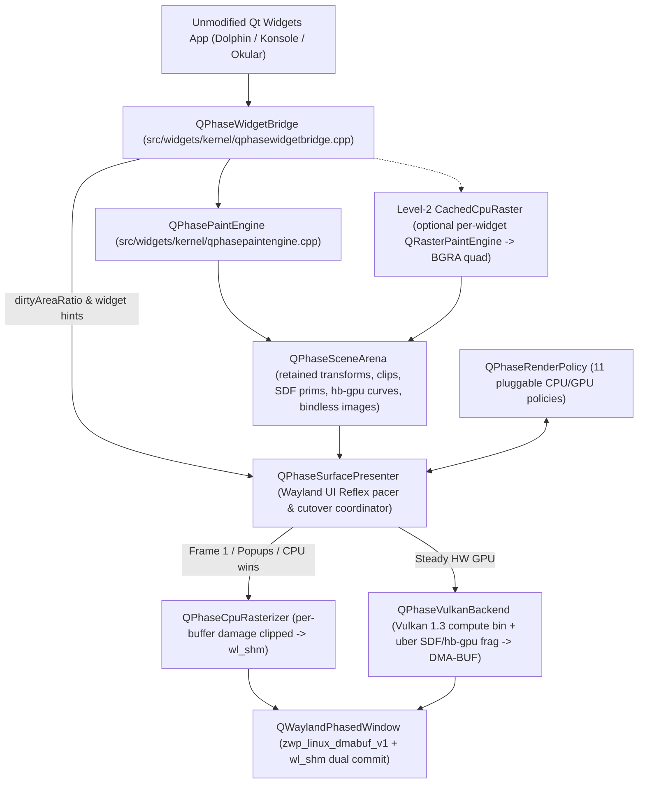

# QtPhase — Retained Hybrid CPU / Vulkan 1.3 Renderer for Unmodified Qt Widgets

> **Status: Experimental Research POC & Architecture Handoff**  
> This branch (`feat/qtphase-renderer`, based on `qtbase v6.11.2`) is an open research proof-of-concept exploring what happens when you back stock **Qt Widgets** on Linux Wayland with a **retained per-widget scene arena**, **Vulkan 1.3 SDF + HarfBuzz `hb-gpu` analytical curve text**, and **pluggable CPU-vs-GPU scheduling policies** — with **zero public Qt Widgets API changes**.
>
> **I am not planning to maintain a Qt fork.** This repository, its demos, its benchmark harnesses, and its empirical findings (including failed hypotheses) are published for KDE, Qt, Mesa, and UI/graphics engineers to inspect, reproduce on other hardware, borrow ideas from, or take further.

---

## Headline Results (Unmodified Stock KDE Apps on Wayland)

Measured on Fedora Linux, KWin Wayland, AMD Renoir integrated GPU (1.5× DPR), Breeze Dark + KDE Plasma platform theme, running stock `/usr/bin/dolphin`, `/usr/bin/okular`, and `/usr/bin/konsole` via `LD_LIBRARY_PATH`:

| Unmodified App & Workload | Upstream Qt (`PHASE=0`) | QtPhase (`1dd0c0ee`) | Speedup |
|---|---:|---:|---:|
| **Dolphin** interactive resize (p50 / p90) | `29.01 / 36.19 ms` | **`6.80 / 9.22 ms`** (`contextual-bandit`) | **4.3× faster** |
| **Dolphin** rapid `Key_Down` navigation (p50 / p90) | `2.05 / 2.53 ms` | **`0.71 / 2.48 ms`** (`widget-aware`) / **`0.85 / 2.27 ms`** (`async-race`) | **2.4–2.9× faster p50** |
| **Konsole** dense monospace resize (p50 / p90) | `27.56 / 34.70 ms` | **`10.46 / 13.12 ms`** (`async-race`) | **2.6× faster** |
| **Okular** 20-page PDF resize (p50) | `23.90 ms` | **`2.17–2.59 ms`** | **9–11× faster** |
| **Okular** smooth scroll from Page 1 (p50 / p90) | `7.21 / 9.29 ms` | **`1.99 ms`** (`contextual-bandit`) / **`2.24 / 7.81 ms`** (`amortized-hybrid`) | **3.2–3.6× faster p50** |
| **Okular** `pageStep` jump (p50) | `6.60 ms` | **`2.76–3.17 ms`** | **2.1–2.4× faster** |
| **Popup menu churn** (`QMenu`, p50) | `3.95 ms` | **`1.19–1.38 ms`** (`0.53 ms` CPU render, `0` Vulkan rings) | **~3× faster** |
| **Cold startup to 1st commit** (Dolphin / Okular, 3-run mean) | `234.6 ms` / `410.5 ms` | **`225.6 ms`** / **`410.2 ms`** | **No regression** (zero-wait CPU boot) |

> **Honest caveat on RAM**: Okular Peak RSS increased from `290.8 MB` (upstream) to `455–492 MB` on most GPU policies (`316.2 MB` on `upload-aware`), due to Vulkan driver overhead + DMA-BUF scanout rings + staging/image residency. See [Known Limitations & Open Research Questions](#known-limitations--open-research-questions).

---

## 1. The Story: Why Build This?

Traditional `Qt Widgets` on Wayland uses a single CPU software backing store (`QBackingStore` → `QRasterPaintEngine` → `wl_shm`). That design is battle-tested and fast for tiny static forms, but it struggles on modern HiDPI displays during:
1. **Interactive window resizing**: every resize reallocates a giant backing buffer and forces synchronous full-window software repainting (`24–36 ms` per step on Dolphin, Konsole, and Okular at 1.5× DPR).
2. **Dense text & smooth scrolling**: software rasterization + full-viewport copies struggle to hold 120 Hz on HiDPI monitors.
3. **Naively "just using Vulkan" breaks desktop ergonomics**: initializing a Vulkan device/swapchain on Frame 1 stalls cold startup, allocating GPU DMA-BUF rings for 20-millisecond tooltips and `QMenu` popups wastes VRAM and latency, and software Vulkan (`llvmpipe`) can be slower than CPU rasterization.

**The core thesis of QtPhase:**
- Keep the **`Qt Widgets` public API 100% unchanged** (`QWidget`, `QPainter`, `QStyle`, Breeze, KIO, Poppler — untouched).
- Replace immediate-mode backing-store painting with a **retained per-`QWidget` scene arena** (`QPhaseSceneArena`) where every widget owns retained transform, clip, and primitive slots. Moving a widget updates a 32-byte transform with **zero `paintEvent()` calls**; small sub-rect invalidations splice only the changed primitives.
- Render the **same scene arena** via two swappable backends behind a Wayland phased surface (`QWaylandPhasedWindow`):
  1. **Zero-wait CPU tile rasterizer** (`QPhaseCpuRasterizer` → `wl_shm`) with per-buffer damage clipping — renders Frame 1 immediately and permanently handles transient `Qt::Popup` / `Qt::ToolTip` windows (`0.53 ms`, `0` GPU buffers).
  2. **Vulkan 1.3 compute + fragment pipeline** (`QPhaseVulkanBackend` → `zwp_linux_dmabuf_v1`) with analytical SDF rounded boxes/lines, bindless zero-copy BGRA textures, and **HarfBuzz `hb-gpu` analytical curve text** (resolution-independent outlines stored in BDA VRAM — zero glyph atlas thrashing).
- Put a **pluggable `QPhaseRenderPolicy` scheduler** in front of both pipelines to empirically test CPU-vs-GPU racing, dynamic switching, cadence-based GPU sleep, and widget-aware routing.

---

## 2. Architecture Map

The entire POC touches **57 files** (`+19,666 / -3` lines on top of `qtbase v6.11.2`), with only **~120 lines of hook code** inside existing `QtWidgets` classes (`qwidget.cpp`, `qwidget_p.h`, `qwidgetrepaintmanager.cpp`, `qwidgetwindow.cpp`):



### Key Files to Read First
| Layer | Files | Role |
|---|---|---|
| **Widgets Seam** | [qwidgetwindow.cpp](src/widgets/kernel/qwidgetwindow.cpp), [qwidgetrepaintmanager.cpp](src/widgets/kernel/qwidgetrepaintmanager.cpp), [qwidget_p.h](src/widgets/kernel/qwidget_p.h) | Minimal (~120 LoC) opt-in hook attaching `QPhaseWidgetBridge` to top-level `QWidgetWindow`s |
| **Retained Tree & Hybrid Bridge** | [qphasewidgetbridge_p.h](src/widgets/kernel/qphasewidgetbridge_p.h), [qphasewidgetbridge.cpp](src/widgets/kernel/qphasewidgetbridge.cpp) | Per-`QWidget` arena node lifecycle, sub-rect opaque-cover partial patching, Level-1 dirty-widget hints, Level-2 `CachedCpuRaster` |
| **`QPainter` Translator** | [qphasepaintengine_p.h](src/widgets/kernel/qphasepaintengine_p.h), [qphasepaintengine.cpp](src/widgets/kernel/qphasepaintengine.cpp) | Translates `QPainter` calls into analytical SDF primitives, zero-alloc monochrome `hb-gpu` glyphs, bindless images, or hashed raster fallbacks |
| **Retained Scene Arena** | [qphasescenearena_p.h](src/phase/qphasescenearena_p.h), [qphasescenearena.cpp](src/phase/qphasescenearena.cpp) | Free-list primitive/transform/clip/image tables, monotonic slot generations for damage diffing, `hb-gpu` curve & face-flag caches, background CPU calibration clones |
| **Pluggable Policy Framework** | [qphaserenderpolicy_p.h](src/phase/qphaserenderpolicy_p.h), [qphaserenderpolicy.cpp](src/phase/qphaserenderpolicy.cpp) | 11 built-in `QPhaseRenderPolicy` implementations selected via `QT_PHASE_POLICY=<name>` |
| **Surface Presenter** | [qphasesurfacepresenter_p.h](src/phase/qphasesurfacepresenter_p.h), [qphasesurfacepresenter.cpp](src/phase/qphasesurfacepresenter.cpp) | Coordinates zero-wait CPU boot, async Vulkan init, per-buffer CPU damage history, background CPU calibration, and resize immediate commits |
| **Vulkan 1.3 Backend** | [qphasevulkanbackend.cpp](src/phase/vulkan/qphasevulkanbackend.cpp), [src/phase/shaders/](src/phase/shaders/) | Shared `VkDevice` cache (~196 µs secondary window init), bucketed DMA-BUF scanout, FIFO bindless cooldown, zero-copy `B8G8R8A8_UNORM` uploads, compute tile binning + uber fragment shader |
| **CPU Tile Rasterizer** | [qphasecpurasterizer.cpp](src/phase/cpu/qphasecpurasterizer.cpp), [qphasesharedmath_p.h](src/phase/cpu/qphasesharedmath_p.h) | Shared-math SDF + HarfBuzz rasterizer with per-buffer damage-region clipping |
| **Wayland Integration** | [qwaylandphasedwindow.cpp](src/plugins/platforms/wayland/qwaylandphasedwindow.cpp) | Dual `wl_shm` + `zwp_linux_dmabuf_v1` presentation on a single `wl_surface` |

---

## 3. The Investigation: Milestones, Bottlenecks & Falsified Hypotheses

This POC evolved through four empirical cycles, driven by real KDE app profiling rather than microbenchmarks:

### Stage A — Zero-Wait Startup, Sub-Rect Partial Patching & Zero-Copy Uploads (`d8057d9d` → `a1a53d5d`)
- **Shared `VkDevice` + Bucketed DMA-BUF Scanout (`e0d2d1ac`)**: Secondary windows reuse the process-wide `VkDevice` in **~196 µs** (verified in `parity_diff` Stage 6) and allocate bucketed DMA-BUF targets so resize storms don't churn `vkCreateImage` on every pixel step.
- **Zero-Wait Hardware GPU Startup (`64ca68ff`)**: Instead of stalling Frame 1 waiting for Vulkan pipeline compilation, Frame 1 paints immediately on `wl_shm` while Vulkan warms up asynchronously; Dolphin 1st-commit latency went from slower-than-upstream to **`225.6 ms` vs `234.6 ms` upstream**.
- **Opaque-Cover Sub-Rect Partial Patching (`64ca68ff`)**: Large viewports (`KItemListView`, `QTreeView`, `QTextEdit`) splice only the dirty sub-rect's primitives in place whenever the patch paints an opaque cover, cutting Dolphin `Key_Down` from full viewport repaints to sub-2 ms.
- **Zero-Copy BGRA/RGB32 Image Uploads (`a1a53d5d`)**: Okular's Poppler tiles arrive as `Format_ARGB32_Premultiplied` / `Format_RGB32`. Uploading directly to `VK_FORMAT_B8G8R8A8_UNORM` (with `A=1` swizzle for `RGB32`) in a single contiguous `memcpy` + `VMA_MEMORY_USAGE_AUTO_PREFER_HOST` staging with `> 4 MB` transient shrink eliminated CPU format conversion stalls and cut Okular smooth scroll to **3× faster than upstream**.

### Stage B — Pluggable `QPhaseRenderPolicy` Arena & CPU Partial-Tile Damage (`fcf893df` → `20191201`)
- **The `sync-race` False-Demotion Bug**: Our first naive race policy compared measured GPU time (`4.93 ms` on Okular) against a synthetic `4.0 ms` CPU guess when Vulkan finished warming before Frame 1, misclassifying Okular permanently onto CPU (**`64 ms` resize!**).
  - **Fix (`async-race`)**: Clone the live scene arena (`QPhaseSceneArena::cloneForCpuCalibration()`) and measure the *real* CPU tile render cost asynchronously on a background thread (`cpu_calib = 24.88 ms` on Okular) with **0 ms** UI-thread stall.
- **10× Faster CPU Partial Updates (`20191201`)**: Originally, `presentCpuFrame()` re-rasterized the entire `wl_shm` window on every 6% edit — and worse, `QPhaseDamageTracker` had a subtle free-list bug where recycling primitive slots shifted `survivingCurOrder` indices, causing a false full-screen dirty cascade!
  - **Fix**: Per-buffer `wl_shm` damage history (`CpuBootBufferState`) passed to `QPhaseCpuRasterizer::renderToBuffer()` + monotonic `m_primSlotGens` in `QPhaseSceneArena` excluded from z-order shift diffs. `QTreeView` partial CPU raster dropped **`17.5–23.0 ms` → `1.61–1.81 ms` (~10×)**, and Dolphin `cpu-only` `Key_Down` dropped **`11.53 ms` → `4.52 ms` (2.5×)**.

### Stage C — 36-Run Policy Arena & Falsified Hypotheses (`1dd0c0ee`)
We implemented **11 policies** in [qphaserenderpolicy.cpp](src/phase/qphaserenderpolicy.cpp) to test competing scheduling hypotheses:
- **Static / Race**: `async-race` *(default)*, `sync-race`, `hw-gpu`, `cpu-only`, `gpu-only`
- **Dynamic / Adaptive**: `dynamic-hybrid`, `amortized-hybrid`, `cadence-power`, `upload-aware`, `contextual-bandit`, `widget-aware`

Running all policies across Konsole, Dolphin, Okular, and `bench_adversarial` **falsified three intuitive ideas**:
1. **`upload-aware` was 2× SLOWER on dynamic fallback canvases (`25.60 ms` vs `13.10 ms` GPU = `13.08 ms` upstream)**:
   - *Hypothesis*: Heavy per-frame `emitRasterFallback()` paths churn GPU uploads, so demoting the window to CPU should be faster.
   - *Reality*: `emitRasterFallback()` *already* rasterizes complex paths into a `QImage`. Uploading via zero-copy BGRA staging costs `< 1 ms` on GPU, whereas demoting to `QPhaseCpuRasterizer` forces **double-rasterization** (CPU `QPainter` → `QImage` → scalar CPU resample into `wl_shm`).
2. **`dynamic-hybrid` thrashed on rapid interactive edits (`8` switches on Dolphin, `p90 = 12.23 ms`)**:
   - Switching mid-window between DMA-BUF and `wl_shm` incurs a cold-buffer transition spike that wipes out any small-damage CPU savings.
3. **Level-2 `CachedCpuRaster` aggressive mode was 2× SLOWER on dense terminals (`20.97–21.21 ms` vs `10.46–10.91 ms` native Vulkan on Konsole)**:
   - *Hypothesis*: Routing dense 2,300+ glyph widgets (`Konsole::TerminalDisplay`, `QPlainTextEdit`) to direct `QRasterPaintEngine` → single BGRA quad would beat emitting thousands of `HbGpuCurve` primitives.
   - *Reality*: Native Vulkan `HbGpuCurve` beats software rasterization + uploading a 7 MB full-viewport image every resize by **2×**. Level-2 `CachedCpuRaster` therefore defaults to `correctness` mode only (`CompositionMode != SourceOver`, curved `clipPath`, `QGraphicsEffect`), while `QT_PHASE_WIDGET_HYBRID=aggressive` remains available for experimentation.

### Stage D — Zero-Allocation Monochrome Glyph Fast Path (`1dd0c0ee`)
Profiling `bench_adversarial` revealed that emitting 4,300 `QPlainTextEdit` glyphs spent `10.7–12.3 ms` on the CPU just constructing temporary `QRawFont`, `QList<quint32>`, `QList<QPointF>`, `QGlyphRun`, and `std::vector<uint32_t>` clip copies, plus calling `hb_gpu_draw_encode()` on every space (`' '`) every frame.
- Caching `hb_face_t` color-table flags once per face, caching empty/whitespace glyphs as `0u`, removing the per-primitive clip vector copy, and adding a zero-alloc monochrome glyph loop in `QPhasePaintEngine::drawTextItem()` cut `QPlainTextEdit` 4,300-glyph sync in **half** (`10.7–12.3 ms` → **`5.44 ms`**), dropped Dolphin `KeyNav` to **`0.71–0.85 ms`**, and dropped Konsole resize to **`10.46 ms`**.

---

## 4. Full Benchmark Data

> **Environment**: Fedora Linux, KWin Wayland, AMD Renoir APU (1.5× DPR), Breeze Dark + KDE Plasma theme.  
> **Note**: The 9-policy arena tables below were single-run sweeps taken right before the Stage D glyph fast path; the **Post-Glyph Fast Path** section shows updated runs for the top contenders on `1dd0c0ee`.

### 4.1 Konsole (Dense Monospace Terminal — Resize + Sparse `160 ms` Typing)
| Policy | Resize p50 | Resize p90 | Sparse Type p50 | Frames (CPU / GPU) | Switches | Avg CPU | Avg GPU HW |
|---|---:|---:|---:|---:|---:|---:|---:|
| `upstream` (`PHASE=0`) | `27.56 ms` | `34.70 ms` | `0.22 ms` | — | — | — | — |
| `async-race` | `10.61 ms` | `12.41 ms` | `0.22 ms` | `0 / 103` | `0` | — | `2.25 ms` |
| `dynamic-hybrid` | **`10.22 ms`** | **`12.03 ms`** | `0.22 ms` | `31 / 76` | `5` | `3.44 ms` | `2.68 ms` |
| `amortized-hybrid` | `10.69 ms` | `12.36 ms` | `0.22 ms` | `9 / 90` | `2` | `5.07 ms` | **`2.24 ms`** |
| **`cadence-power`** | `10.96 ms` | `12.81 ms` | `0.22 ms` | **`11 / 91`** | **`1`** | **`2.62 ms`** | `2.56 ms` |
| `upload-aware` | `10.83 ms` | `12.56 ms` | `0.22 ms` | `0 / 103` | `0` | — | `2.27 ms` |
| `contextual-bandit` | `11.29 ms` | `19.37 ms` | `0.22 ms` | `27 / 74` | `4` | `5.52 ms` | `2.48 ms` |
| `cpu-only` | `33.52 ms` | `40.74 ms` | `0.22 ms` | `99 / 0` | `0` | `6.24 ms` | `0.00 ms` |
| `gpu-only` | `10.70 ms` | `12.18 ms` | `0.22 ms` | `0 / 103` | `0` | — | `2.33 ms` |

*Notable*: `cadence-power` stayed GPU during resize, then switched **once** (`Sw=1`) to CPU partial-tile (`2.62 ms`, 0 GPU wakeups) during sparse `160 ms` typing.

### 4.2 Dolphin (File Manager — Resize + Rapid `Key_Down` Selection)
| Policy | Resize p50 | Resize p90 | `KeyNav` p50 | `KeyNav` p90 | Frames (CPU / GPU) | Switches | Avg GPU HW |
|---|---:|---:|---:|---:|---:|---:|---:|
| `upstream` (`PHASE=0`) | `29.01 ms` | `36.19 ms` | `2.05 ms` | `2.53 ms` | — | — | — |
| `async-race` | `7.14 ms` | `10.20 ms` | `2.00 ms` | `4.05 ms` | `0 / 131` | `0` | `1.82 ms` |
| `dynamic-hybrid` | `7.18 ms` | `10.62 ms` | `4.25 ms` | `12.23 ms` | `46 / 83` | `8` | `2.47 ms` |
| `amortized-hybrid` | `7.17 ms` | `10.08 ms` | **`0.86 ms`** | `13.69 ms` | `12 / 117` | `4` | `1.85 ms` |
| `cadence-power` | `7.46 ms` | `9.89 ms` | `1.93 ms` | `3.63 ms` | `0 / 129` | `0` | `1.76 ms` |
| `upload-aware` | **`6.90 ms`** | `9.69 ms` | `1.00 ms` | `3.61 ms` | `0 / 130` | `0` | `1.80 ms` |
| **`contextual-bandit`** | `6.97 ms` | **`9.50 ms`** | **`1.02 ms`** | **`2.26 ms`** | `2 / 130` | `2` | `1.79 ms` |
| `cpu-only` | `32.60 ms` | `38.64 ms` | `4.12 ms` | `11.74 ms` | `126 / 0` | `0` | `0.00 ms` |
| `gpu-only` | `7.63 ms` | `11.62 ms` | `1.99 ms` | `3.90 ms` | `0 / 128` | `0` | `1.74 ms` |

### 4.3 Okular (20-Page PDF — Resize + Smooth Scroll from Page 1 + `pageStep` Jump)
| Policy | Resize p50 | Scroll p50 | Scroll p90 | Jump p50 | Peak RSS | Frames (CPU / GPU) | Switches | Avg GPU HW |
|---|---:|---:|---:|---:|---:|---:|---:|---:|
| `upstream` (`PHASE=0`) | `23.90 ms` | `7.21 ms` | `9.29 ms` | `6.60 ms` | `290.8 MB` | — | — | — |
| `async-race` | `2.59 ms` | `2.39 ms` | `10.18 ms` | `3.17 ms` | `455.6 MB` | `0 / 135` | `0` | `6.39 ms` |
| `dynamic-hybrid` | `2.44 ms` | `2.41 ms` | `10.06 ms` | `3.55 ms` | `490.4 MB` | `2 / 138` | `2` | `6.48 ms` |
| **`amortized-hybrid`** | `2.48 ms` | `2.24 ms` | **`7.81 ms`** | `3.02 ms` | `459.6 MB` | `0 / 138` | `0` | `6.50 ms` |
| `cadence-power` | `2.53 ms` | `2.10 ms` | `8.42 ms` | `2.79 ms` | `492.3 MB` | `0 / 137` | `0` | `6.32 ms` |
| `upload-aware` | **`2.17 ms`** | `2.07 ms` | `14.07 ms` | **`2.76 ms`** | **`316.2 MB`** | `0 / 136` | `0` | `6.53 ms` |
| **`contextual-bandit`** | `2.32 ms` | **`1.99 ms`** | `9.81 ms` | `3.40 ms` | `468.0 MB` | `0 / 139` | `0` | `6.49 ms` |
| `cpu-only` | `64.40 ms` | `31.98 ms` | `32.88 ms` | `33.93 ms` | `345.6 MB` | `118 / 0` | `0` | `0.00 ms` |
| `gpu-only` | `2.34 ms` | `2.29 ms` | `9.91 ms` | `3.18 ms` | `455.3 MB` | `0 / 139` | `0` | `6.37 ms` |

### 4.4 Adversarial 4-Phase Stress Suite (`bench_adversarial`)
| Policy | Sparse Typing p50 | Dynamic Fallback p50 | Popup Churn p50 | Popups (CPU / GPU) | Main Frames (CPU / GPU) | Switches |
|---|---:|---:|---:|---:|---:|---:|
| `upstream` (`PHASE=0`) | `1.59 ms` | `13.08 ms` | `3.95 ms` | — | — | — |
| **`async-race`** | **`0.87 ms`** | `13.10 ms` | **`1.38 ms`** | **`7 / 0`** | `3 / 133` | `1` |
| `dynamic-hybrid` | `2.75 ms` | `13.93 ms` | `4.58 ms` | `11 / 0` | `22 / 117` | `3` |
| `amortized-hybrid` | `2.04 ms` | **`12.70 ms`** | `4.49 ms` | `9 / 0` | `5 / 132` | `3` |
| `upload-aware` | `1.87 ms` | **`25.60 ms`** *(2× loss!)* | `4.08 ms` | `10 / 0` | `59 / 79` | `2` |
| `contextual-bandit` | `2.36 ms` | `14.46 ms` | `4.13 ms` | `9 / 0` | `28 / 111` | `5` |
| `cpu-only` | `2.29 ms` | `27.83 ms` | `2.40 ms` | `7 / 0` | `146 / 0` | `0` |
| `gpu-only` | `2.27 ms` | `13.1 ms` | `4.21 ms` | **`0 / 11`** *(allocates GPU rings)* | `3 / 137` | `1` |

### 4.5 Post-Glyph Fast Path Runs (`1dd0c0ee`)
| Policy | Dolphin Resize (p50 / p90) | Dolphin `KeyNav` (p50 / p90) | Konsole Resize (p50 / p90) | `bench_adversarial` Popup Churn p50 |
|---|---:|---:|---:|---:|
| `upstream` (`PHASE=0`) | `29.01 / 36.19 ms` | `2.05 / 2.53 ms` | `27.56 / 34.70 ms` | `3.95 ms` |
| **`async-race`** | `6.93 / 9.34 ms` | `0.85 / 2.27 ms` | **`10.46 / 13.12 ms`** | **`1.19 ms`** |
| **`contextual-bandit`** | **`6.80 / 9.22 ms`** | `1.87 / 2.61 ms` | `11.29 / 17.92 ms` | `4.04 ms` |
| **`widget-aware`** | `7.14 / 8.99 ms` | **`0.71 / 2.48 ms`** | `11.77 / 14.41 ms` | `4.79 ms` |

---

## 5. Verdict & Known Limitations / Open Research Questions

### Current Verdict
On an integrated AMD GPU today, **staying on Vulkan for main windows + routing transient `Qt::Popup`/`Qt::ToolTip` windows to CPU `wl_shm`** (`async-race`) is the strongest latency strategy. Once Vulkan is initialized (~200 µs for secondary windows via shared `VkDevice`), GPU beats CPU partial-tile even on small edits (`0.7–1.0 ms` vs `4.1 ms` on Dolphin `KeyNav`), so aggressive mid-window CPU↔GPU switching mostly adds `p90` tail spikes. `contextual-bandit` and `widget-aware` are close runners-up, and `cadence-power` is the cleanest laptop/power-saving hybrid (`Sw=1` on Konsole sparse typing).

### Known Limitations & Open Problems (Where to Pick This Up)
This study is **not yet hardware-conclusive** and intentionally leaves several major problems open for anyone taking the ideas forward:

1. **Okular RSS Overhead (`+165 MB`)**: Needs profiling of Vulkan DMA-BUF scanout rings, VMA pools, staging retention, and cached Poppler page `QPixmap` lifetimes across multi-window desktop sessions.
2. **Untested Hardware Classes**:
   - **Discrete GPUs (NVIDIA / AMD dGPU)**: PCIe upload tax and D3cold GPU sleep/wake latency (`5–30 ms`) could make `cadence-power` or `widget-aware` beat static GPU.
   - **Intel iGPU & Software Vulkan (`llvmpipe` / VM)**: Need verification that `async-race` and `contextual-bandit` reliably lock onto CPU permanently under `llvmpipe`.
3. **End-to-End Frame-to-Glass Timing**: Current benchmarks measure up to `wl_surface.commit` / presenter completion alongside `Avg GPU HW`; adding Wayland `wp_presentation` feedback timestamps would close the loop on scanout latency.
4. **Warm Mid-Window CPU↔GPU Switching**: Eliminating the cold-buffer transition spike (`p90` `12–14 ms` on `dynamic-hybrid` / `amortized-hybrid`) would make dynamic hybrid policies far more competitive under GPU contention (e.g., gaming/video playback alongside Qt Widgets).
5. **Font Rendering & Desktop Fidelity**: Subpixel LCD AA, hinting parity across fractional DPR scales, `QOpenGLWidget` / `QQuickWidget` embedding, and full `QPainter` blend-mode / `QGraphicsEffect` edge cases.
6. **Multi-Trial Statistical Sweep**: Run 5× multi-trial medians across all policies on `1dd0c0ee`, plus short-lived `QDialog` open/interact/close benchmarks to properly evaluate `widget-aware`.

---

## 6. Quickstart: Build, Demos & Reproducible Benchmarks

### Prerequisites (Linux Wayland)
- CMake ≥ 3.22, Ninja, C++20 compiler
- Vulkan 1.3 headers/loader + `glslangValidator` (or `glslc`) + Vulkan Memory Allocator (`vma`)
- HarfBuzz with `hb-gpu` support, Wayland development protocols (`zwp_linux_dmabuf_v1`)

### 1. Build `qtbase` (`Phase`, `Widgets`, Wayland QPA)
```bash
cmake -S . -B ../build-qtbase -G Ninja \
  -DCMAKE_BUILD_TYPE=Release \
  -DQT_BUILD_EXAMPLES=OFF \
  -DQT_BUILD_TESTS=OFF

cmake --build ../build-qtbase --target Phase Widgets qwayland --parallel $(( $(nproc) - 1 ))
```

### 2. Build the Demos & Benchmark Suite (`examples/phase/`)
```bash
cmake -S examples/phase -B ../build-phase-demos -G Ninja \
  -DCMAKE_PREFIX_PATH="$(realpath ../build-qtbase)"

cmake --build ../build-phase-demos --parallel $(( $(nproc) - 1 ))
```

### 3. Run Pixel-Parity Verification & Interactive Demos
```bash
export LD_LIBRARY_PATH="$(realpath ../build-qtbase/lib)"
export QT_PLUGIN_PATH="$(realpath ../build-qtbase/plugins):/usr/lib64/qt6/plugins"
export QT_QPA_PLATFORM=wayland

# 7-stage CPU <-> Vulkan 1.3 verification suite
../build-phase-demos/parity_diff

# Standard Qt Widgets app (ZERO QtPhase includes — compare QT_WIDGETS_PHASE=0 vs 1!)
../build-phase-demos/widgets_phase_demo

# Native QtPhase showcase (100k-row virtualized table, hb-gpu text, embedded Vulkan 3D pass)
../build-phase-demos/phase_demo
```

### 4. Run Any Unmodified Stock KDE / Qt Widgets App on QtPhase
```bash
LD_LIBRARY_PATH="$(realpath ../build-qtbase/lib)" \
QT_PLUGIN_PATH="$(realpath ../build-qtbase/plugins):/usr/lib64/qt6/plugins" \
QT_QPA_PLATFORM=wayland \
QT_PHASE_POLICY=async-race \
QT_WIDGETS_PHASE_STATS=1 \
  dolphin
```

### 5. Reproduce the Policy Arena Benchmarks
```bash
QTBASE_BUILD_DIR="$(realpath ../build-qtbase)" \
DEMOS_BUILD_DIR="$(realpath ../build-phase-demos)" \
  ./examples/phase/benchmarks/run_arena.sh upstream async-race contextual-bandit widget-aware cadence-power
```

### Environment Variable Reference
| Variable | Values | Purpose |
|---|---|---|
| `QT_WIDGETS_PHASE` | `1` *(default)* / `0` | Toggle QtPhase vs stock upstream Qt Widgets `QBackingStore` for A/B testing |
| `QT_PHASE_POLICY` | `async-race` *(default)*, `contextual-bandit`, `widget-aware`, `cadence-power`, `amortized-hybrid`, `dynamic-hybrid`, `upload-aware`, `sync-race`, `hw-gpu`, `cpu-only`, `gpu-only` | Select the CPU-vs-GPU scheduling policy |
| `QT_PHASE_WIDGET_HYBRID` | `correctness` *(default)* / `aggressive` / `off` | Control Level-2 per-widget `CachedCpuRaster` routing |
| `QT_WIDGETS_PHASE_STATS` | `1` | Print per-window CPU/GPU frame counts, switches, and avg CPU/GPU HW times on exit |
| `QT_WIDGETS_PHASE_PROFILE` | `1` | Print per-frame sync/upload/present timing and policy transitions to `stderr` |
